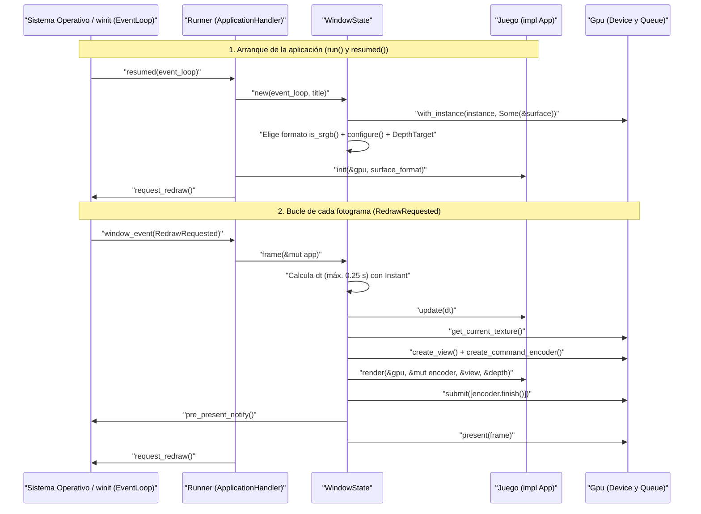

# `grisu-platform`: ventana, bucle de eventos y presentación en pantalla

`grisu-platform` es la capa del motor Grisú que conecta el sistema operativo (ventanas, teclado y bucle de eventos mediante `winit`) con el renderizador gráfico ([grisu-render.md](grisu-render.md)).

Su objetivo principal es ocultar toda la fontanería de creación de ventana, negociación de formatos de color con el monitor y manejo de superficies perdidas o redimensionadas. De este modo, el ejecutable del juego (`hush-client`) solo tiene que implementar un trait muy simple de tres métodos llamado `App`.

---

## 1. Regla de arquitectura: independencia total del motor

En el repositorio rige una regla estricta: **ningún crate del motor (`grisu-render`, `grisu-platform`) puede depender de ningún crate del juego (`hush-sim`, `hush-client`, `hush-cli`)**.

¿Cómo puede entonces `grisu-platform` ejecutar el bucle principal del juego sin conocer `hush-client`? Mediante **inversión de dependencias** a través del trait público `App`:

- `grisu-platform` define el contrato (`App`) y es dueño del bucle de eventos en la función pública `run()`.
- `hush-client` importa `grisu-platform`, define su propia estructura de estado (`CubeDemo` en el Hito 0), implementa `App` para ella y se la entrega a `run()`.

Gracias a este diseño, el motor Grisú es reutilizable y puede probarse o evolucionar sin acoplarse a las reglas de minería de HUSHMINE.

---

## 2. Estructura del crate

El crate vive en `crates/grisu-platform` y consta de dos archivos:

| Archivo | Qué contiene y para qué sirve |
|---|---|
| `crates/grisu-platform/Cargo.toml` | Declara las dependencias necesarias para abrir y gestionar la ventana: `grisu-render`, `winit`, `wgpu`, `pollster` (para bloquear en la inicialización asíncrona de la GPU), `log` y `anyhow`. |
| `crates/grisu-platform/src/lib.rs` | Contiene toda la implementación en menos de 200 líneas: el trait público `App`, la función pública `run()` y las dos estructuras privadas que gobiernan el ciclo de vida de la ventana (`Runner` y `WindowState`). |

### Piezas internas de `crates/grisu-platform/src/lib.rs`

1. **El trait `App`**: el contrato que implementa el juego. Tiene tres métodos:
   - `init()`: se llama una sola vez cuando la ventana, la `Gpu` y el formato de textura de la pantalla (`TextureFormat`) ya están listos.
   - `update()`: se llama en cada fotograma con el tiempo transcurrido `dt` (en segundos) desde el fotograma anterior.
   - `render()`: recibe la `Gpu`, un grabador `CommandEncoder`, la vista de color `TextureView` del fotograma actual y el `DepthTarget` para grabar las órdenes de dibujo.
2. **La función `run()`**: recibe el título de la ventana y cualquier tipo que implemente `App`. Crea el `EventLoop` de `winit` con `new()`, construye el `Runner` y lanza `run_app()`.
3. **La estructura `Runner`**: envuelve la aplicación del usuario (`app`), el estado de la ventana (`state` como `Option` de `WindowState`, que empieza vacío en `None`) y un posible error de arranque (`error`). Implementa el trait `ApplicationHandler` de `winit` con los métodos `resumed()` y `window_event()`.
4. **La estructura `WindowState`**: agrupa todos los recursos ligados a la ventana activa:
   - `window`: la ventana `Window` de `winit` envuelta en un puntero compartido con conteo de referencias (`Arc`), necesario porque tanto `WindowState` como la `Surface` de `wgpu` deben compartir su propiedad.
   - `surface`: la superficie de dibujo (`Surface`) donde `wgpu` entrega las imágenes a la ventana.
   - `config`: la configuración activa de la superficie (`SurfaceConfiguration`), con su ancho, alto y formato de píxel.
   - `gpu`: el contexto `Gpu` de `grisu-render`.
   - `depth`: el búfer de profundidad (`DepthTarget`) acoplado al tamaño actual de la ventana.
   - `last_frame`: marca de tiempo (`Instant`) del último fotograma para calcular `dt`.

---

## 3. Ciclo de vida y flujo completo de un fotograma

El siguiente diagrama de secuencia muestra todo el recorrido desde que `run()` arranca hasta que un fotograma se presenta en el monitor y se solicita el siguiente:

---

## 4. Qué ocurre paso a paso en cada etapa

### 4.1. Inicio en `resumed()` y por qué se elige un formato sRGB

En `winit` 0.30, una aplicación no debe crear su ventana directamente antes de arrancar el bucle de eventos, porque en varios sistemas operativos los recursos gráficos solo son válidos cuando el sistema notifica que la aplicación está activa mediante el evento `resumed()`.

Por eso `Runner` empieza con `state` en `None` y espera a que `winit` invoque `resumed()`:

1. **Creación de la ventana**: el constructor `new()` de `WindowState` pide al `ActiveEventLoop` crear una ventana (`create_window()`) con el título indicado y un tamaño lógico inicial de **1280×720** píxeles (`LogicalSize`).
2. **Conexión entre `winit` y `wgpu`**: se toma el manejador de pantalla del bucle de eventos (`new_with_display_handle()`) junto con los backends seguros de `default_backends()`, se crea la `Instance` de `wgpu` y, a partir del `Arc` de `Window`, se crea la `Surface` con `create_surface()`.
3. **Inicialización síncrona de la GPU**: como `with_instance()` de `Gpu` es una función `async` pero el callback `resumed()` de `winit` es síncrono, se usa `block_on()` de `pollster` para esperar a que la tarjeta gráfica esté lista. Al pasarle la `Surface`, `wgpu` garantiza elegir una tarjeta gráfica capaz de mostrar imágenes en esa ventana.
4. **Elección del formato sRGB (`is_srgb()`)**: `WindowState` obtiene una configuración base con `get_default_config()`, consulta las capacidades de la superficie con `get_capabilities()` y busca entre sus formatos soportados el primero que cumpla `is_srgb()` de `TextureFormat`. Esto es fundamental: las capturas sin ventana de `render_to_image()` usan `Rgba8UnormSrgb`. Al elegir también un formato sRGB en la ventana, la conversión gamma es idéntica y el juego se ve exactamente con el mismo brillo y color en ventana que en las capturas PNG revisadas por la IA.
5. **Configuración inicial y `DepthTarget`**: se aplica la configuración con `configure()`, se construye el `DepthTarget` del mismo ancho y alto con `new()`, se llama por única vez a `init()` en `App` y se solicita el primer dibujado con `request_redraw()`.

Si cualquier paso de `new()` en `WindowState` devuelve un error (por ejemplo, si la máquina no tiene ninguna GPU compatible), `resumed()` guarda el fallo en `self.error` y llama a `exit()` en el bucle de eventos para que `run()` pueda devolver limpiamente ese `Result` al programa principal sin hacer `panic!`.

### 4.2. Anatomía de un fotograma en `frame()` de `WindowState`

Cada vez que el sistema operativo entrega `RedrawRequested` (`WindowEvent`) en `window_event()`, `Runner` ejecuta `frame()` sobre `WindowState` y acto seguido vuelve a llamar a `request_redraw()` para mantener un bucle continuo de animación. Dentro de `frame()` suceden seis operaciones en orden estricto:

1. **Medición y acotado de `dt`**: se compara `now()` de `Instant` con `self.last_frame` para saber cuántos segundos han pasado desde el fotograma anterior. Ese valor se limita a un máximo de `0.25` segundos (un cuarto de segundo). Sin este tope, si el usuario arrastra la barra de título de la ventana o el ordenador se detiene un par de segundos, el siguiente fotograma recibiría un `dt` enorme y las animaciones darían un salto brusco.
2. **Actualización (`update()`)**: el juego actualiza su estado visual (en el Hito 0, incrementa el ángulo `yaw` de `OrbitCamera` según `SPIN_SPEED`).
3. **Obtención de la textura de pantalla (`get_current_texture()`)**: la ventana tiene una cola interna de imágenes (*swapchain*). Se pide la siguiente imagen libre donde pintar este fotograma y se evalúa el estado `CurrentSurfaceTexture` devuelto:
   - Si es `Success` o `Suboptimal`, tenemos un `frame` válido para dibujar.
   - Si es `Outdated` o `Lost` (algo habitual cuando el usuario cambia la resolución, minimiza o el controlador gráfico se reinicia), se reconfigura la superficie con `configure()` y se salta este fotograma sin fallar.
4. **Creación de `TextureView` y `CommandEncoder`**: se envuelve la textura del fotograma en un `TextureView` (`create_view()`) y se pide al dispositivo un grabador de comandos nuevo (`create_command_encoder()`).
5. **Grabación del renderizado (`render()`)**: el juego anota en el `encoder` todas las pasadas de dibujo usando el `TextureView` de color y el `DepthTarget` (`self.depth`).
6. **Envío y presentación (`submit()` y `present()`)**:
   - `submit()` recibe el resultado de `finish()` del grabador y envía la lista de comandos a la cola `Queue` de la tarjeta gráfica.
   - `pre_present_notify()` avisa al gestor de ventanas del sistema operativo de que estamos a punto de presentar un fotograma nuevo (mejora la sincronización con el compositor de escritorio).
   - `present()` ordena mostrar la imagen terminada en el monitor.

### 4.3. Cambio de tamaño de la ventana (`resize()`)

Cuando el usuario estira o encoge la ventana (o cuando el sistema operativo ajusta su tamaño al abrirla), `window_event()` recibe `Resized` (`WindowEvent`) y llama a `resize()` en `WindowState`:

1. **Protección contra tamaño cero**: si `width == 0` o `height == 0` (lo cual ocurre en Windows al minimizar la ventana a la barra de tareas), `resize()` retorna inmediatamente sin hacer nada. Intentar configurar una superficie de `wgpu` con tamaño 0×0 provocaría un error de validación en la GPU.
2. **Reconfiguración de la `Surface`**: se actualizan `self.config.width` y `self.config.height` y se llama a `configure()` para que las siguientes imágenes entregadas por `get_current_texture()` tengan la nueva resolución.
3. **Recreación obligatoria del `DepthTarget`**: `wgpu` exige que la textura de color y la textura de profundidad de un `RenderPassDescriptor` tengan **exactamente las mismas dimensiones**. Por eso `resize()` sustituye `self.depth` creando un nuevo `DepthTarget` con el nuevo ancho y alto. Además, como el método `render()` de `CubeRenderer` calcula la relación de aspecto (`aspect`) dividiendo `depth.width` entre `depth.height`, la cámara corrige automáticamente su proporción para que el cubo no se vea achatado ni estirado.

### 4.4. Cierre de la ventana y tecla `Escape`

En `window_event()`, dos eventos detienen limpiamente el bucle principal llamando a `exit()` sobre `ActiveEventLoop`:

- `CloseRequested` (`WindowEvent`): el usuario pulsó la «X» de la ventana o usó el atajo de cierre del sistema (como Alt+F4).
- `KeyboardInput` (`WindowEvent`) con un `KeyEvent` cuya tecla lógica es `Escape` (`NamedKey`) en estado `Pressed` (`ElementState`): permite cerrar el juego al instante pulsando `Escape`, tal como requieren los comandos de verificación del proyecto.

---

## 5. Glosario de plataforma y bucle de eventos

| Término | Significado sencillo |
|---|---|
| `App` | Trait público de `grisu-platform` con tres métodos (`init()`, `update()`, `render()`) que desacopla el código del juego de la gestión de ventanas. |
| `ApplicationHandler` | Trait de `winit` implementado por `Runner` para recibir notificaciones del sistema operativo (`resumed()`, `window_event()`). |
| `Arc` y `Window` | `Window` representa la ventana del sistema operativo y `Arc` es un puntero inteligente con conteo atómico de referencias que permite que `WindowState` y `Surface` compartan su propiedad de forma segura. |
| `dt` (*delta time*) | Tiempo en segundos transcurrido entre el fotograma anterior y el actual. Multiplicar las velocidades por `dt` hace que el juego se mueva al mismo ritmo en monitores de 60 Hz o de 144 Hz. |
| `EventLoop` | Bucle central de `winit` que escucha mensajes del sistema operativo (teclado, ratón, redimensionado, repintado) y los despacha a `Runner` mediante `run_app()`. |
| `block_on()` (`pollster`) | Ejecutor mínimo que espera de forma síncrona a que termine una función `async` de Rust (usado para ejecutar `with_instance()` de `Gpu` dentro de `WindowState`). |
| `Surface` | Lienzo conectado a una ventana real del sistema operativo; provee en cada fotograma una textura (`get_current_texture()`) que luego se muestra en el monitor con `present()`. |
| `SurfaceConfiguration` | Estructura que guarda el ancho, alto, formato de color (`TextureFormat`) y modo de presentación con los que se configura la `Surface` mediante `configure()`. |
