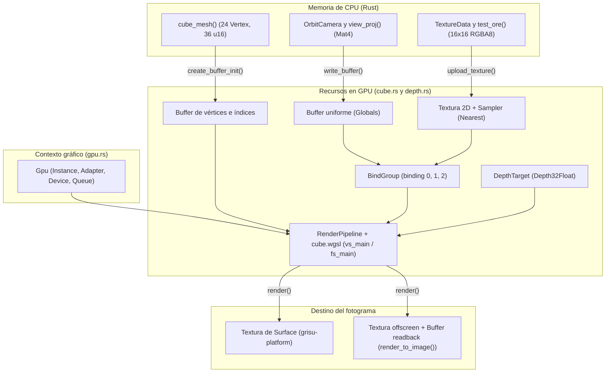

# `grisu-render`: renderizado 3D con wgpu (en ventana y sin ventana)

`grisu-render` es el corazón gráfico del motor Grisú. Su responsabilidad es traducir geometría 3D, texturas y cámaras a órdenes que la tarjeta gráfica (GPU) pueda ejecutar mediante `wgpu` (versión 30).

Siguiendo la regla de arquitectura del repositorio, `grisu-render` no depende de ningún crate del juego (`hush-sim`, `hush-client`, `hush-cli`) ni tampoco sabe qué es una ventana del sistema operativo. Gracias a ese aislamiento, **exactamente el mismo código de dibujo** sirve para dos caminos:

1. Dibujar fotograma a fotograma en una ventana interactiva gestionada por [grisu-platform.md](grisu-platform.md).
2. Dibujar en segundo plano sin abrir ninguna ventana (`render_to_image()`), lo que permite a `hush-cli` y a las pruebas automáticas generar capturas PNG y verificar visualmente el motor desde la terminal.

---

## 1. Mapa de archivos del crate

El crate vive en `crates/grisu-render` y se organiza en archivos pequeños, cada uno con una responsabilidad única:

| Archivo | Qué contiene y para qué sirve |
|---|---|
| `crates/grisu-render/Cargo.toml` | Declara las dependencias del crate: `wgpu` para hablar con la GPU, `glam` para matemáticas 3D (`Vec3`, `Mat4`), `bytemuck` para convertir estructuras de Rust en bytes puros (`Pod`, `Zeroable`), `image` para construir imágenes `RgbaImage`, `pollster` para ejecutar código asíncrono en las pruebas, `log` y `anyhow`. |
| `crates/grisu-render/src/lib.rs` | Punto de entrada del crate. Declara los seis módulos privados (`camera`, `cube`, `depth`, `gpu`, `offscreen`, `texture`), reexporta los tipos y funciones públicos (`OrbitCamera`, `CubeRenderer`, `DepthTarget`, `Gpu`, `default_backends()`, `render_to_image()`, `TextureData`) y define la constante pública `CLEAR_COLOR` (`r: 0.02, g: 0.025, b: 0.035, a: 1.0`), un tono oscuro ligeramente azulado que representa la penumbra de una mina. |
| `crates/grisu-render/src/gpu.rs` | Inicialización de `wgpu`. Define `default_backends()` y la estructura `Gpu` (`instance`, `adapter`, `device`, `queue`) con dos constructores asíncronos: `headless()` para trabajar sin ventana y `with_instance()` para elegir un adaptador compatible con una superficie (`Surface`) si existe. |
| `crates/grisu-render/src/camera.rs` | Define `OrbitCamera`, una cámara que gira en coordenadas esféricas alrededor de un punto `target`. Calcula la posición del ojo en `eye()` y la matriz combinada de vista y proyección en `view_proj()`. |
| `crates/grisu-render/src/depth.rs` | Define `DepthTarget`, que envuelve la textura de profundidad en formato `Depth32Float` (`FORMAT`) y su vista `TextureView` creada en `new()`. Evita que las caras lejanas se pinten encima de las cercanas. |
| `crates/grisu-render/src/texture.rs` | Define `TextureData` (ancho, alto y vector `rgba` en bytes) y el generador procedural determinista `test_ore()`, que produce una textura de 16×16 píxeles de roca gris con vetas naranjas y borde más oscuro usando la función privada `hash()`. Incluye las pruebas `test_ore_is_16x16_and_has_ore()` y `test_ore_is_deterministic()`. |
| `crates/grisu-render/src/cube.rs` | Define `CubeRenderer`, encargado de dibujar el cubo unitario del Hito 0 mediante `new()` y `render()`. Contiene los tipos privados `Vertex` y `Globals`, la subida de texturas en `upload_texture()`, la generación geométrica en `cube_mesh()` y las pruebas `cube_has_24_vertices_and_12_triangles()` y `cube_faces_wind_counter_clockwise_from_outside()`. |
| `crates/grisu-render/src/cube.wgsl` | Programa (*shader*) en lenguaje WGSL que se ejecuta dentro de la GPU. Contiene las estructuras `Globals`, `VertexIn` y `VertexOut`, el *vertex shader* `vs_main()` y el *fragment shader* `fs_main()`. |
| `crates/grisu-render/src/offscreen.rs` | Implementa `render_to_image()`, que crea un lienzo en la GPU, dibuja el cubo, copia los píxeles de la GPU a la memoria de la CPU respetando el alineamiento de 256 bytes (`COPY_BYTES_PER_ROW_ALIGNMENT`) y devuelve un `RgbaImage`. |
| `crates/grisu-render/tests/offscreen.rs` | Prueba de integración `offscreen_cube_renders_over_clear_color()`. Arranca con `headless()` (si no hay adaptador salta la prueba, salvo que la variable de entorno `HUSH_REQUIRE_GPU` valga `1`), renderiza una imagen de 128×128 y comprueba que la esquina sea oscura, el centro brillante y aparezcan píxeles naranjas del mineral. |

---

## 2. Flujo general de datos hasta el píxel

El siguiente diagrama muestra cómo se relacionan las piezas de `grisu-render` desde la inicialización de `Gpu` hasta que los píxeles llegan a la ventana o a un archivo PNG:



---

## 3. Inicialización de la GPU y selección de backend (`crates/grisu-render/src/gpu.rs`)

Cuando un programa quiere usar la tarjeta gráfica a través de `wgpu`, necesita crear cuatro objetos encadenados que se guardan juntos en la estructura `Gpu`:

1. `Instance`: el punto de entrada que interroga al sistema operativo para saber qué librerías gráficas están instaladas (DirectX 12, Vulkan, Metal u OpenGL).
2. `Adapter`: representa una tarjeta gráfica concreta (dedicada, integrada o por software). Se solicita en `with_instance()` mediante `request_adapter()` pidiendo máximo rendimiento (`HighPerformance`).
3. `Device`: la conexión lógica con esa tarjeta gráfica, creada con `request_device()`. A través de `device` se reservan búferes, texturas y *pipelines*. Para maximizar la compatibilidad con gráficas modestas, se piden los límites base de WebGL2 (`downlevel_webgl2_defaults()`) ajustados a la resolución máxima real del adaptador (`using_resolution()` y `limits()`).
4. `Queue`: la cola de trabajo a la que se envían las órdenes grabadas (`submit()`) y las transferencias rápidas de datos desde la CPU (`write_buffer()`, `write_texture()`).

### Por qué `default_backends()` evita Vulkan en Windows

En Windows, la función `default_backends()` devuelve `DX12` y `GL` en lugar de incluir Vulkan. Esto se debe a un fallo conocido en ciertos controladores (como la gráfica integrada Intel UHD 620 con el driver `31.0.101.2137`), donde el cargador de Vulkan cierra abruptamente el proceso al intentar crear la instancia. En otros sistemas operativos se utiliza `PRIMARY` junto con `GL`. En cualquier caso, si se define la variable de entorno `WGPU_BACKEND`, el método `with_env()` permite forzar otro backend sin recompilar.

---

## 4. Conceptos clave explicados desde cero

### 4.1. Cámara orbital y matrices (`crates/grisu-render/src/camera.rs`)

La GPU no entiende directamente qué es una «cámara»; solo sabe proyectar puntos a través de una matriz matemática de 4×4 números (`Mat4`). `OrbitCamera` almacena cinco parámetros fáciles de manipular (con valores iniciales en `Default`):

- `target`: el punto 3D (`Vec3`) al que mira la cámara (por defecto, el origen `ZERO`).
- `distance`: la distancia desde `target` hasta la cámara (por defecto, `3.2` unidades).
- `yaw` y `pitch`: los ángulos en radianes de giro horizontal (`0.6`) e inclinación vertical (`0.5`).
- `fov_y`: el ángulo de apertura vertical de la lente (por defecto, 50 grados convertidos con `to_radians()`).

El método `eye()` usa senos y cosenos (`sin_cos()`) para convertir `yaw`, `pitch` y `distance` en la posición exacta del ojo en el espacio 3D. Después, `view_proj()` multiplica dos matrices de `glam`:
- La **matriz de vista** (`look_at_mat4()`), que coloca el mundo desde el punto de vista del ojo con el eje Y apuntando hacia arriba.
- La **matriz de proyección en perspectiva** (`perspective()`), que hace que los objetos lejanos se vean más pequeños siguiendo la convención de coordenadas de DirectX que usa `wgpu`: eje Y hacia arriba y profundidad Z normalizada entre `0.0` (plano cercano a `0.05`) y `1.0` (plano lejano a `500.0`).

### 4.2. Geometría del cubo y conversión a bytes (`crates/grisu-render/src/cube.rs`)

Un cubo tiene 8 esquinas físicas, pero `cube_mesh()` genera un `Vec` de **24 vértices** (4 por cada una de sus 6 caras) y otro `Vec` de **36 índices** `u16` (2 triángulos × 3 vértices × 6 caras). ¿Por qué no reutilizar las 8 esquinas? Porque cada cara tiene su propio brillo fijo (`shade`) y sus propias coordenadas de textura (`uv` de `0.0` a `1.0`):

- Cara superior (`+Y`): `shade = 1.00` (la más iluminada).
- Caras laterales (`+X` y `-X`): `shade = 0.80`.
- Caras frontal y trasera (`+Z` y `-Z`): `shade = 0.65`.
- Cara inferior (`-Y`): `shade = 0.50` (la más oscura).

Este sombreado plano por cara reproduce la estética limpia de Infiniminer sin necesidad de calcular luces dinámicas costosas. Además, `cube_mesh()` coloca los vértices de cada cara en sentido antihorario (*counter-clockwise*, `Ccw`) vistos desde fuera del cubo, algo que verifican las pruebas `cube_has_24_vertices_and_12_triangles()` y `cube_faces_wind_counter_clockwise_from_outside()`.

Para enviar los tipos `Vertex` y `Globals` a la tarjeta gráfica sin usar código `unsafe`, ambos llevan `#[repr(C)]` (que garantiza el orden exacto de los campos en memoria) y derivan `Pod` (*Plain Old Data*) y `Zeroable` del crate `bytemuck`. Así pueden convertirse de forma segura en tajadas de bytes listas para `create_buffer_init()` y `write_buffer()`.

### 4.3. Qué es un `RenderPipeline` y cómo conecta Rust con el shader WGSL

Una tarjeta gráfica moderna funciona como una cadena de montaje ultrarrápida pero rígida. Un `RenderPipeline` (creado en `new()` de `CubeRenderer` mediante `create_render_pipeline()` y `RenderPipelineDescriptor`) es la configuración completa y precompilada de esa cadena de montaje. Define tanto las etapas fijas del hardware como los pequeños programas (*shaders*) de `crates/grisu-render/src/cube.wgsl`:

1. **Entrada de vértices (`VertexBufferLayout`)**: indica a la GPU cómo leer el búfer `vertices`. Cada elemento tiene el tamaño de `Vertex` y contiene tres atributos: `@location(0)` es `position` (`Float32x3`), `@location(1)` es `uv` (`Float32x2`) y `@location(2)` es `shade` (`Float32`).
2. **Etapa de vértices (`vs_main()` en `crates/grisu-render/src/cube.wgsl`)**: se ejecuta una vez por cada uno de los 24 vértices. Recibe un `VertexIn`, multiplica la posición 3D por la matriz de cámara (`view_proj`) para obtener la posición proyectada (`clip`) y pasa `uv` y `shade` sin cambios hacia la siguiente etapa a través de `VertexOut`.
3. **Ensamblado de triángulos y descarte de caras traseras (`PrimitiveState`)**: agrupa los vértices de tres en tres (`TriangleList`). Como se configura la cara frontal con `Ccw` (`FrontFace`) y el descarte (`cull_mode`) con `Back` (`Face`), cualquier triángulo cuyos vértices queden en sentido horario en pantalla (es decir, una cara del cubo que está de espaldas a la cámara) se descarta inmediatamente sin gastar tiempo en pintarlo.
4. **Etapa de fragmentos (`fs_main()` en `crates/grisu-render/src/cube.wgsl`)**: se ejecuta para cada píxel que cubre un triángulo visible. Consulta el color de la textura en las coordenadas interpoladas `uv` mediante `textureSample()`, multiplica sus canales rojo, verde y azul por el factor de brillo de la cara (`shade`) y devuelve el color final con opacidad `1.0`.

### 4.4. Qué es un `BindGroup` y cómo viajan cámara, textura y sampler a la GPU

Además de los vértices del modelo, el shader `crates/grisu-render/src/cube.wgsl` necesita leer tres recursos externos declarados en la cabecera del archivo:

```wgsl
@group(0) @binding(0) var<uniform> globals: Globals;
@group(0) @binding(1) var block_texture: texture_2d<f32>;
@group(0) @binding(2) var block_sampler: sampler;
```

En `wgpu`, estos recursos no se pasan uno por uno en cada dibujo, sino empaquetados en un **grupo de enlaces** (`BindGroup`):

- Primero se define el diseño del grupo (*bind group layout*) con `create_bind_group_layout()` y `BindGroupLayoutDescriptor`, que declara cada entrada (`BindGroupLayoutEntry`), qué tipo de recurso va en cada número de `binding` y qué etapa del shader tiene permiso para verlo (`VERTEX` en `ShaderStages` para el `binding` 0, y `FRAGMENT` para los `binding` 1 y 2).
- Después se crea el paquete concreto con `create_bind_group()` y `BindGroupDescriptor`, conectando los tres objetos reales en memoria de GPU:
  - **Enlace 0 (`globals`)**: el búfer uniforme (`UNIFORM`) que contiene la matriz `Globals`. En cada fotograma, el método `render()` de `CubeRenderer` actualiza su contenido llamando a `write_buffer()`.
  - **Enlace 1 (`texture_view`)**: la vista `TextureView` de la textura 16×16 creada y subida a la GPU por `upload_texture()` mediante `create_texture()` y `write_texture()` en formato `Rgba8UnormSrgb`.
  - **Enlace 2 (`sampler`)**: el muestreador (`Sampler`) creado con `create_sampler()` usando el filtro `Nearest` (`FilterMode`) tanto al ampliar como al reducir. Si se usase filtrado lineal, la textura de 16×16 se vería borrosa; con `Nearest`, cada píxel del mineral conserva bordes cuadrados y nítidos.

### 4.5. Qué es el búfer de profundidad (`DepthTarget` y `Depth32Float`)

Si la GPU se limitara a pintar los 12 triángulos del cubo uno tras otro en el lienzo de color, el resultado dependería del orden en que están guardados en el búfer de índices: un triángulo lejano pero listado al final se pintaría encima de otro más cercano.

Para resolver esto existe `DepthTarget` (`crates/grisu-render/src/depth.rs`). Es una segunda imagen invisible del mismo ancho y alto que el lienzo de color, pero en lugar de guardar colores RGB guarda un número decimal de 32 bits por píxel (`Depth32Float`) que representa la distancia a la cámara (entre `0.0` cerca y `1.0` lejos):

1. Al comenzar la pasada de dibujo en `begin_render_pass()` (`RenderPassDescriptor`), el lienzo de color se limpia con `CLEAR_COLOR` y el `DepthTarget` se rellena entero con `1.0` (`Clear` en `LoadOp`), que equivale a «infinitamente lejos».
2. El `RenderPipeline` tiene configurada en `DepthStencilState` la comparación `Less` (`CompareFunction`) y la escritura de profundidad activada.
3. Cada vez que `fs_main()` va a pintar un píxel a una distancia $z$, la GPU compara $z$ con el valor guardado en `DepthTarget` para esa misma coordenada:
   - Si $z$ es **menor** (`Less`), el nuevo píxel está más cerca de la cámara: se pinta el color y se actualiza `DepthTarget` con la nueva distancia $z$.
   - Si $z$ es **mayor o igual**, hay algo delante tapándolo: el píxel se descarta automáticamente, y al terminar la pasada se libera su contenido temporal con `Discard` (`StoreOp`).

### 4.6. Cómo funciona la captura sin ventana (`render_to_image()` y `headless()`)

Uno de los pilares del proyecto es que tanto una persona como un agente de IA puedan comprobar qué está dibujando el motor ejecutando `hush-cli` o las pruebas de integración, sin depender de un monitor físico. Este proceso ocurre entre `headless()` y `render_to_image()` (`crates/grisu-render/src/offscreen.rs`):

1. **GPU sin pantalla (`headless()`)**: crea la instancia de `wgpu` con `new_without_display_handle()` y llama a `with_instance()` pasando `None` como `Option` de superficie. Así la tarjeta gráfica trabaja puramente en memoria.
2. **Textura destino (`target`)**: `render_to_image()` crea una textura 2D en formato `Rgba8UnormSrgb` con dos banderas de uso: `RENDER_ATTACHMENT` (para que `render()` de `CubeRenderer` pueda dibujar sobre ella) y `COPY_SRC` (para poder copiar sus píxeles después).
3. **El requisito de alineamiento de 256 bytes**: la memoria interna de una textura en la GPU está organizada para lecturas bidimensionales rápidas, por lo que la CPU no puede leerla directamente. Hay que copiar la textura a un `Buffer` intermedio (`readback`) con permisos `COPY_DST` y `MAP_READ`. Sin embargo, la especificación de `wgpu` exige que, al copiar de textura a búfer con `copy_texture_to_buffer()`, la longitud en bytes de cada fila (`padded_row`) sea múltiplo exacto de `COPY_BYTES_PER_ROW_ALIGNMENT` (**256 bytes**).
   - Por ejemplo, si la imagen mide 100 píxeles de ancho, cada fila real (`unpadded_row`) ocupa $100 \times 4 = 400$ bytes, pero en el búfer `readback` cada fila debe ocupar 512 bytes (el siguiente múltiplo de 256), dejando 112 bytes de relleno (*padding*) al final de cada fila.
4. **Sincronización entre GPU y CPU**: tras grabar las órdenes en un `CommandEncoder` (con `create_command_encoder()` y `finish()`) y enviarlas con `submit()`, se solicita mapear el búfer en memoria accesible por la CPU mediante `map_async()` (en modo `Read` de `MapMode`) y se espera a que la GPU termine todas sus tareas llamando a `poll()` con `wait_indefinitely()` (`PollType`).
5. **Limpieza del relleno y creación del `RgbaImage`**: una vez disponible el rango mapeado con `get_mapped_range()`, se recorre en bloques de tamaño `padded_row` pero se copian al vector `pixels` únicamente los primeros `unpadded_row` bytes de cada fila. Finalmente se libera el mapeo con `unmap()` y se construye el `Result` con la imagen final mediante `from_raw()` de `RgbaImage`.

---

## 5. Qué cambiará en el Hito 1

En el estado actual (Hito 0), `grisu-render` dibuja un único cubo de mineral para validar de extremo a extremo la cadena gráfica, la profundidad y las capturas sin ventana. En el **Hito 1** (terreno de vóxeles), este crate evolucionará en tres frentes principales:

- **Cámara en primera persona**: además de `OrbitCamera` (útil para inspeccionar escenas y depurar), se añadirá una cámara en primera persona controlada por la posición y mirada del jugador.
- **Mallas de *chunks* en lugar de un único cubo**: en vez de generar los 24 vértices fijos de `cube_mesh()` dentro de `CubeRenderer`, el cliente construirá mallas dinámicas por trozos del mundo (*chunks* de bloques), emitiendo únicamente las caras visibles entre bloques sólidos y bloques de aire.
- **Atlas o array de texturas**: en lugar de subir una sola textura de prueba con `test_ore()`, el shader podrá muestrear distintos tipos de roca, tierra, mena y estructuras de los equipos.

---

## 6. Glosario de términos gráficos y de Rust

| Término | Significado sencillo |
|---|---|
| `Adapter` | Representación en `wgpu` de una tarjeta gráfica física o por software instalada en la máquina. |
| `BindGroup` | Paquete de recursos (búferes uniformes, texturas y *samplers*) que se conecta con `set_bind_group()` antes de dibujar para que el shader pueda leerlos. |
| `Buffer` | Bloque lineal de memoria alojado en la tarjeta gráfica (sirve para guardar vértices, índices, matrices o píxeles copiados). |
| `CommandEncoder` | Grabador en el que la CPU anota una lista de órdenes de dibujo (`draw_indexed()`) y copia antes de enviarlas juntas a la GPU con `submit()`. |
| `DepthTarget` | Textura auxiliar (`Depth32Float`) que guarda a qué distancia de la cámara está cada píxel ya pintado, evitando que lo lejano tape a lo cercano. |
| `Device` | Conexión lógica activa con la tarjeta gráfica; se usa para crear todos los recursos en memoria de vídeo. |
| `Pod` y `Zeroable` | Traits del crate `bytemuck` que certifican que un `struct` de Rust son puros bytes contiguos sin punteros ni huecos inválidos, permitiendo copiarlo a la GPU sin `unsafe`. |
| `Queue` | Cola de ejecución de la GPU que recibe los comandos grabados (`submit()`) y las escrituras directas de datos (`write_buffer()`, `write_texture()`). |
| `RenderPipeline` | Configuración compilada de toda la cadena de dibujo en la GPU: formato de vértices, shaders (`vs_main()`, `fs_main()`), descarte de caras y prueba de profundidad. |
| `Sampler` | Objeto que indica a la GPU cómo leer una textura cuando se estira o encoge; con `Nearest` (`FilterMode`) mantiene los píxeles cuadrados y nítidos. |
| *Shader* (WGSL) | Programa pequeño (`crates/grisu-render/src/cube.wgsl`) que se ejecuta en paralelo dentro de la GPU para transformar vértices (`vs_main()`) y colorear píxeles (`fs_main()`). |
| *sRGB* (`Rgba8UnormSrgb`) | Espacio de color estándar de los monitores que aplica corrección gamma automáticamente al guardar los colores, haciendo que las sombras se vean naturales. |
| *Uniform* (`Globals`) | Dato constante durante todo un dibujo (como la matriz `view_proj` de la cámara) que todos los vértices o fragmentos leen al mismo tiempo. |
| *Winding* (`Ccw`) | Orden de giro (antihorario) en que se listan las tres esquinas de un triángulo para saber qué lado mira hacia fuera del objeto y cuál hacia dentro. |
