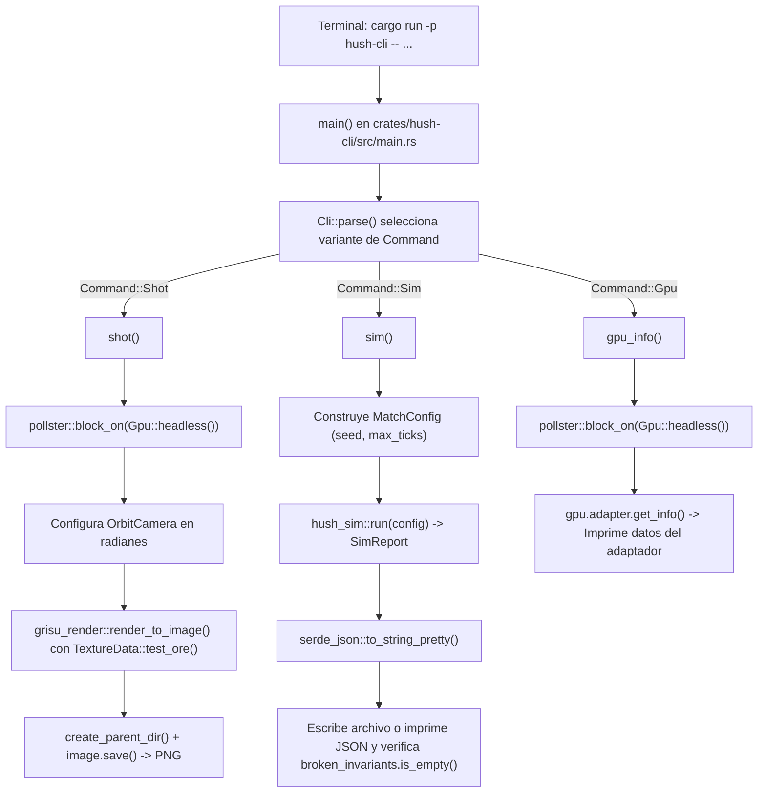

# Herramientas de terminal: `hush-cli`

El crate `hush-cli` (ubicado en `crates/hush-cli/`) compila el binario de línea de comandos del proyecto. Es la **navaja suiza de verificación**: permite tanto a las personas que desarrollan el juego como a los agentes de inteligencia artificial probar la simulación, fotografiar escenas 3D reales en la tarjeta gráfica e inspeccionar los controladores de vídeo desde la terminal, sin necesidad de abrir una ventana interactiva.

Si revisas `crates/hush-cli/Cargo.toml`, verás que este crate actúa como puente de pruebas entre las dos mitades de la arquitectura:
- Conecta con **`grisu-render`** para inicializar la GPU en modo sin cabeza (`Gpu::headless()`) y dibujar en memoria (`render_to_image()`).
- Conecta con **`hush-sim`** para lanzar partidas deterministas (`hush_sim::run()`) y serializar sus informes (`SimReport`) con `serde_json`.
- Utiliza `clap` para definir los argumentos de consola, `anyhow` para propagar errores legibles, `pollster` para resolver llamadas asíncronas de inicialización de GPU y `env_logger` para los mensajes de diagnóstico.

---

## Arquitectura y despacho de comandos (`crates/hush-cli/src/main.rs`)

Todo el código actual vive en `crates/hush-cli/src/main.rs`. En la parte superior se declaran dos tipos decorados con macros de `clap`:

- **`struct Cli`** (`#[derive(Parser)]`): representa la invocación del programa `hush-cli` y contiene el subcomando elegido.
- **`enum Command`** (`#[derive(Subcommand)]`): enumera las tres operaciones disponibles hoy en `main`: `Shot`, `Sim` y `Gpu`.

Cuando ejecutas el binario, la función `main()` configura el registro de eventos con `env_logger` (mostrando avisos `warn` por defecto), interpreta los argumentos mediante `Cli::parse()` y redirige la ejecución a la función interna correspondiente:



---

## Los tres subcomandos al detalle

### 1. `hush-cli shot`: capturas 3D sin ventana

Dibuja un fotograma utilizando exactamente el mismo motor gráfico (`grisu-render`) que usa el cliente del juego, pero volcando los píxeles a una textura en memoria en lugar de a una pantalla, y guarda el resultado como un archivo PNG.

**Ejemplo de uso habitual:**
```bash
cargo run -p hush-cli -- shot --out out/shot.png
```

**Argumentos disponibles en `Command::Shot`:**

| Argumento | Tipo en Rust | Valor por defecto | Descripción |
|---|---|---|---|
| `--out` | `PathBuf` | `"out/shot.png"` | Ruta donde se guardará la imagen PNG resultante. |
| `--width` | `u32` | `512` | Anchura de la captura en píxeles. |
| `--height` | `u32` | `512` | Altura de la captura en píxeles. |
| `--yaw` | `f32` | `35.0` | Giro horizontal de la cámara alrededor del objetivo, expresado en grados. |
| `--pitch` | `f32` | `28.0` | Inclinación vertical de la cámara, expresada en grados. |

**Qué hace `shot()` por dentro paso a paso:**
1. Llama a `pollster::block_on(Gpu::headless())?` para pedir a `grisu-render` un dispositivo `wgpu` sin ventana asociada.
2. Construye una `OrbitCamera` convirtiendo `yaw` y `pitch` de grados a radianes con `to_radians()` y tomando la distancia y el objetivo de `OrbitCamera::default()`.
3. Llama a `render_to_image(&gpu, width, height, &camera, &TextureData::test_ore())?`, que crea el búfer de profundidad (`DepthTarget`), dibuja el cubo con la textura procedural de mineral (`TextureData::test_ore()`) y descarga los píxeles de la GPU a la memoria principal.
4. Asegura que la carpeta de salida exista llamando a `create_parent_dir(out)?` (que usa `fs::create_dir_all()`).
5. Codifica y escribe el archivo PNG en disco con `image.save(out)`, añadiendo un mensaje claro mediante `with_context()` si el disco falla.

**Qué comprueba:** permite verificar que los shaders WGSL compilan, que el búfer de profundidad y las transformaciones de `OrbitCamera` son correctos y que el resultado visual es el esperado (abriéndolo para inspeccionar la imagen).

---

### 2. `hush-cli sim`: simulación acelerada e informe JSON

Ejecuta una partida completa de `hush-sim` tan rápido como lo permite el procesador (sin esperar el paso del tiempo real) y emite el informe `SimReport` en formato JSON.

**Ejemplo de uso habitual:**
```bash
cargo run -p hush-cli -- sim --seed 42 --report out/sim.json
```

**Argumentos disponibles en `Command::Sim`:**

| Argumento | Tipo en Rust | Valor por defecto | Descripción |
|---|---|---|---|
| `--seed` | `u64` | `42` | Semilla inicial para el generador determinista `Rng`. |
| `--ticks` | `Option<u32>` | `None` (`28_800`) | Cantidad de ticks a simular. Si se omite, usa el valor de `MatchConfig::default()` (`16 * 60 * TICK_RATE`, es decir, 16 minutos de partida). |
| `--report` | `Option<PathBuf>` | `None` | Ruta donde guardar el informe JSON. Si no se pasa, el JSON se imprime directamente en la terminal. |

**Qué hace `sim()` por dentro paso a paso:**
1. Crea un `MatchConfig` con la `seed` indicada y el resto de valores de `MatchConfig::default()`. Si el usuario especificó `--ticks`, actualiza `config.max_ticks`.
2. Ejecuta `hush_sim::run(config)` (descrito en [hush-sim.md](hush-sim.md)), que corre todos los ticks y devuelve un `SimReport`.
3. Convierte el `SimReport` a texto JSON indentado mediante `serde_json::to_string_pretty(&report)?`.
4. Si `report_path` es `Some(path)`, crea la carpeta padre con `create_parent_dir(path)?` y guarda el archivo con `fs::write(path, &json)`. Si es `None`, lo muestra por pantalla.
5. **Verificación crítica de invariantes**: antes de terminar con `Ok(())`, ejecuta:
   ```rust
   anyhow::ensure!(
       report.broken_invariants.is_empty(),
       "invariantes rotas: {:?}",
       report.broken_invariants
   );
   ```
   Si durante la simulación se violó alguna regla de integridad del juego y `broken_invariants` no está vacío, `hush-cli` devuelve un error y detiene cualquier flujo de integración continua.

**Ejemplo del informe JSON generado:**
```json
{
  "seed": 42,
  "ticks": 28800,
  "game_seconds": 960.0,
  "state_hash": "8a5e391b4c20f71d",
  "tick_p50_us": 0.1,
  "tick_p95_us": 0.2,
  "tick_max_us": 14.5,
  "broken_invariants": []
}
```

---

### 3. `hush-cli gpu`: diagnóstico del adaptador gráfico

Muestra qué tarjeta gráfica y qué API de bajo nivel está seleccionando el motor en la máquina actual. No recibe argumentos adicionales.

**Ejemplo de uso habitual:**
```bash
cargo run -p hush-cli -- gpu
```

**Qué hace `gpu_info()` por dentro:**
1. Inicializa la GPU sin ventana con `pollster::block_on(Gpu::headless())?`.
2. Obtiene los metadatos del hardware llamando a `gpu.adapter.get_info()`.
3. Imprime cuatro líneas con el diagnóstico del adaptador:
   - **Nombre de la GPU**: identificador comercial del adaptador (`info.name`).
   - **Backend gráfico**: API activa (`info.backend`, como DirectX 12, OpenGL o Vulkan).
   - **Tipo de dispositivo**: clase de hardware (`info.device_type`: GPU dedicada, integrada, virtual o CPU).
   - **Controlador**: nombre y versión instalada (`info.driver` e `info.driver_info`).

**Por qué es importante:** en equipos Windows con gráficos integrados Intel UHD 620, ciertos controladores de Vulkan cierran el proceso al crear la instancia. Por eso `grisu_render::default_backends()` prioriza DirectX 12 y OpenGL en Windows. Con `hush-cli gpu` puedes confirmar al instante qué backend se ha elegido o probar otro forzando la variable de entorno `WGPU_BACKEND`.

---

## Utilidades internas y manejo de errores

En `crates/hush-cli/src/main.rs`, tanto `shot()` como `sim()` comparten una función auxiliar para preparar las rutas de salida:

```rust
fn create_parent_dir(path: &Path) -> Result<()> {
    if let Some(parent) = path.parent().filter(|p| !p.as_os_str().is_empty()) {
        fs::create_dir_all(parent)
            .with_context(|| format!("no se pudo crear {}", parent.display()))?;
    }
    Ok(())
}
```

Gracias al trait `Context` de `anyhow` (método `with_context()`), si falla la creación de una carpeta o la escritura de un archivo, el usuario no recibe un mensaje genérico del sistema operativo («acceso denegado» o «archivo no encontrado»), sino la ruta exacta que causó el fallo.

---

## Evolución prevista en los próximos hitos

A medida que el proyecto avance según lo planificado en [PLAN_v4.md](../../PLAN_v4.md), `crates/hush-cli/src/main.rs` incorporará nuevas capacidades manteniendo la misma filosofía de verificación sin ventana:

- **Escenas descriptivas (`.ron`) en `shot`**: posibilidad de cargar archivos de escena para fotografiar terrenos de vóxeles completos, cortes de cuevas, lava, iluminación y estados concretos de la interfaz desde cámaras predefinidas.
- **Reproducción y verificación (`replay`)**: un subcomando para cargar la grabación de una partida real o simulada, volver a ejecutarla tick a tick en `hush-sim` y comprobar que el `state_hash` final coincide exactamente con el original.
- **Pruebas de presupuesto de rendimiento (`bench`)**: mediciones automatizadas del tiempo de generación de terreno, mallado de chunks y coste por tick bajo carga intensa.
