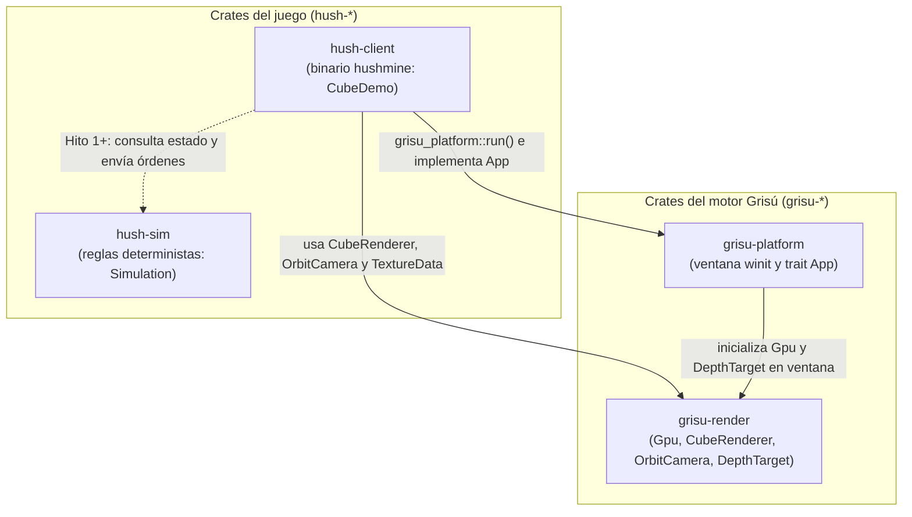
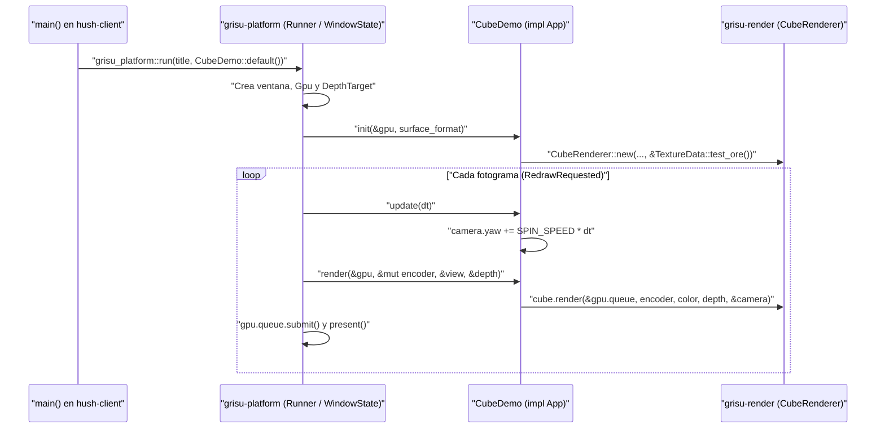

# El cliente del juego: `hush-client`

El crate `hush-client` (ubicado en `crates/hush-client/`) compila el binario ejecutable principal del juego: **`hushmine`**. Mientras que `hush-sim` calcula las reglas sin gráficos y `hush-cli` ejecuta herramientas de terminal sin ventana, `hush-client` es la aplicación interactiva que abre una ventana en el escritorio del jugador.

En el estado actual del repositorio (Hito 0), `crates/hush-client/src/main.rs` ocupa apenas 45 líneas y cumple un objetivo muy concreto: **demostrar de extremo a extremo que `grisu-platform` y `grisu-render` funcionan juntos en una ventana real**, mostrando un cubo con textura de mineral que gira suavemente hasta que el usuario cierra la ventana o pulsa la tecla Escape.

---

## Relación con el resto del workspace

Si consultas `crates/hush-client/Cargo.toml` en `main` (Hito 0), verás que el binario `hushmine` se apoya hoy directamente en el motor **Grisú** y se conectará en el Hito 1 con la simulación de **HUSHMINE**:

- **`grisu-platform`** (`crates/grisu-platform/`): crea la ventana del sistema operativo, gestiona el bucle de eventos, controla el redimensionamiento y define el trait `App`.
- **`grisu-render`** (`crates/grisu-render/`): administra la GPU (`Gpu`), la cámara (`OrbitCamera`), el búfer de profundidad (`DepthTarget`), las texturas (`TextureData`) y el renderizador del cubo (`CubeRenderer`).
- **`wgpu`**, **`anyhow`** y **`env_logger`**: proporcionan los tipos gráficos de la superficie de dibujo, el retorno de errores en `main()` y el registro de mensajes en consola.
- **`hush-sim`** (`crates/hush-sim/`, conexión prevista a partir del Hito 1): contiene las reglas deterministas de la partida (explicadas en [hush-sim.md](hush-sim.md)), a las que el cliente enviará órdenes de movimiento y excavación.

El siguiente diagrama ilustra cómo se conectan los crates hoy y dónde encaja `hush-sim`:



---

## Anatomía de `CubeDemo` (`crates/hush-client/src/main.rs`)

Todo el código actual de `crates/hush-client/src/main.rs` gira en torno a una constante y una estructura:

```rust
const SPIN_SPEED: f32 = 0.6;

#[derive(Default)]
struct CubeDemo {
    cube: Option<CubeRenderer>,
    camera: OrbitCamera,
}
```

### Por qué `cube` es un `Option<CubeRenderer>`

Cuando el programa arranca en `main()`, la línea `grisu_platform::run("HUSHMINE", CubeDemo::default())` crea primero la instancia de `CubeDemo` en memoria y se la entrega al bucle de eventos del sistema operativo.

En ese primer instante **todavía no existe la ventana ni se ha inicializado la tarjeta gráfica**, por lo que aún no es posible subir vértices, texturas ni shaders a la GPU. En Rust, en lugar de usar punteros nulos (que causan fallos de segmentación en otros lenguajes), se declara explícitamente esa ausencia temporal con `Option<CubeRenderer>`:
- Al crearse con `CubeDemo::default()`, el campo `cube` vale `None` y `camera` toma los valores iniciales de `OrbitCamera::default()`.
- En cuanto `grisu-platform` recibe la confirmación del sistema operativo de que la ventana está lista y ha configurado la superficie `wgpu`, invoca `init()` y `self.cube` pasa a ser `Some(CubeRenderer)`.

---

## Implementación del contrato `App`

Para que el código del juego sea limpio y fácil de mantener, `CubeDemo` no toca directamente la biblioteca de ventanas ni la negociación de superficies de `wgpu`. En su lugar, implementa los tres métodos del trait `grisu_platform::App`:



### 1. Inicialización de recursos gráficos: `init()`

```rust
fn init(&mut self, gpu: &Gpu, surface_format: wgpu::TextureFormat) {
    self.cube = Some(CubeRenderer::new(
        &gpu.device,
        &gpu.queue,
        surface_format,
        &TextureData::test_ore(),
    ));
}
```

- **Cuándo se llama**: una única vez al arrancar la ventana.
- **Qué recibe**: una referencia a `Gpu` (que contiene `device` y `queue`) y el formato de píxeles `surface_format` elegido para la pantalla (preferiblemente sRGB para que los colores en ventana coincidan exactamente con las capturas generadas por [hush-cli.md](hush-cli.md)).
- **Qué hace**: construye el `CubeRenderer` cargando la textura procedural de prueba (`TextureData::test_ore()`) y lo almacena en `self.cube`.

### 2. Avance de presentación por fotograma: `update()`

```rust
fn update(&mut self, dt: f32) {
    self.camera.yaw += SPIN_SPEED * dt;
}
```

- **Cuándo se llama**: una vez antes de dibujar cada fotograma.
- **Qué recibe**: `dt`, el tiempo real en segundos transcurrido desde el fotograma anterior (calculado con `Instant::now()` en `grisu-platform` y limitado a un máximo de `0.25` segundos para evitar saltos si el usuario mueve la ventana).
- **Qué hace**: gira suavemente la cámara horizontalmente (`yaw`) a razón de `0.6` radianes por segundo (`SPIN_SPEED`), independientemente de si el monitor va a 60 Hz o a 144 Hz.

### 3. Grabación del dibujo: `render()`

```rust
fn render(
    &mut self,
    gpu: &Gpu,
    encoder: &mut wgpu::CommandEncoder,
    color: &wgpu::TextureView,
    depth: &DepthTarget,
) {
    if let Some(cube) = &self.cube {
        cube.render(&gpu.queue, encoder, color, depth, &self.camera);
    }
}
```

- **Cuándo se llama**: en cada fotograma, inmediatamente después de `update()`.
- **Qué recibe**: la `Gpu`, el codificador de comandos (`encoder`) donde se graban las órdenes de dibujo del fotograma, la vista de color de la ventana (`color`) y el búfer de profundidad (`depth`).
- **Qué hace**: comprueba de forma segura con `if let Some(cube) = &self.cube` que el renderizador ya esté inicializado y le ordena grabar el pase de renderizado con la posición actual de `self.camera`.

---

## Regla fundamental de arquitectura: la frontera entre cliente y simulación

En el diseño de **HUSHMINE** hay dos leyes arquitectónicas inquebrantables que determinan qué código puede escribirse dentro de `crates/hush-client/`:

1. **Ningún crate `grisu-*` depende de un crate `hush-*`**: el motor gráfico (`grisu-render`) y de plataforma (`grisu-platform`) no sabe qué es un minero, ni qué es el Sismógrafo, ni cuántos tipos de bloque existen. Solo sabe abrir ventanas, mover cámaras y dibujar geometría.
2. **El cliente solo dibuja, suena y envía órdenes; las reglas viven en `hush-sim`**:
   - En `hush-client` sí está permitido usar números en coma flotante (`f32`) como `SPIN_SPEED` o `dt`, porque solo afectan a la suavidad visual de la cámara y a la interpolación entre fotogramas en la pantalla local del jugador.
   - Sin embargo, ninguna decisión de reglas (si un bloque se rompe, cuánto mineral se entrega, si la lava avanza o si el Sismógrafo alcanza el Despertar) se calcula jamás en `hush-client`. El cliente recoge las pulsaciones de teclado y ratón, las transforma en órdenes para `hush-sim` y dibuja el estado resultante que `hush-sim` le devuelve.

---

## Punto de entrada (`main()`) y ciclo de cierre

El archivo `crates/hush-client/src/main.rs` termina con una función `main()` minimalista:

```rust
fn main() -> anyhow::Result<()> {
    env_logger::Builder::from_env(env_logger::Env::default().default_filter_or("info")).init();
    grisu_platform::run("HUSHMINE", CubeDemo::default())
}
```

1. **Registro de actividad**: inicializa `env_logger` con el nivel `"info"` por defecto (a diferencia de `hush-cli`, que usa `"warn"` para no ensuciar la salida JSON de la terminal).
2. **Arranque de la ventana**: invoca `grisu_platform::run("HUSHMINE", CubeDemo::default())`, que abre una ventana de 1280×720 píxeles lógicos con el título `"HUSHMINE"`.
3. **Cierre limpio**: dentro de `crates/grisu-platform/src/lib.rs`, el manejador de ventana escucha tanto el botón de cierre de la ventana (`WindowEvent::CloseRequested`) como la pulsación de la tecla Escape (`NamedKey::Escape`). Al producirse cualquiera de los dos eventos, sale limpiamente del bucle y devuelve `Ok(())` a `main()`.

