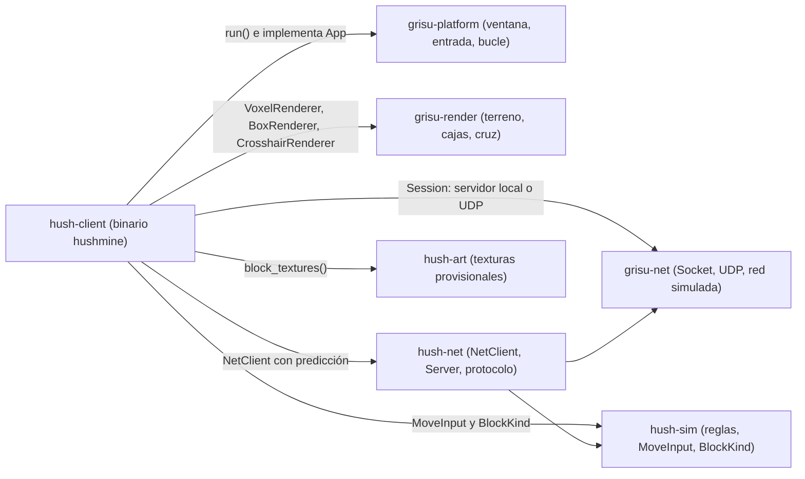

# Cliente del juego: `hush-client`

El crate `hush-client` produce el binario `hushmine`. Es la parte del juego que dibuja, lee el teclado y el ratón y envía órdenes; **las reglas no viven aquí**, sino en `hush-sim`, y el estado autoritativo lo decide siempre un servidor (`hush-net`).

Desde el hito 2 el cliente juega **siempre a través de la red**: sin argumentos arranca un servidor local en memoria con el mismo código que el servidor dedicado; con `--connect` se une a un `hush-server` por UDP.

```text
hushmine [--seed N] [--bots N] [--connect HOST:PUERTO] [--name NOMBRE]
```

---

## Dependencias



---

## Módulos

| Archivo | Papel |
|---|---|
| `crates/hush-client/src/main.rs` | Lee los argumentos (`parse_args`), resuelve la dirección del servidor (`resolve`) y entrega un `Game` a `grisu_platform::run()`. |
| `crates/hush-client/src/session.rs` | `Session`: une el `NetClient` con un servidor local (`Server` sobre `SimNetwork` sin pérdidas) o con un socket `UdpTransport`. Al destruirse se despide del servidor. |
| `crates/hush-client/src/game.rs` | `Game`: implementa el trait `App`, convierte la entrada en `MoveInput` y `Action`, avanza los ticks a 30 Hz y dibuja. |

---

## Un fotograma de `Game`

```mermaid
sequenceDiagram
    participant Plat as "grisu-platform"
    participant Game as "Game (impl App)"
    participant Ses as "Session"
    participant Net as "NetClient"

    Plat->>Game: update(dt, input)
    Game->>Ses: poll() (en local, también avanza el servidor)
    Game->>Game: acumula dt; por cada tick de 33 ms...
    Game->>Ses: tick(MoveInput, Action)
    Ses->>Net: predice y encola la entrada numerada
    Game->>Ses: flush() (envía los paquetes)
    Plat->>Game: render(gpu, encoder, color, depth)
    Game->>Game: terreno, otros jugadores y cruz
```

1. **Entrada**: el ratón gira la `FlyCamera`; WASD y espacio se convierten en un `MoveInput` cuantizado (`MoveInput::from_direction`) relativo a la cámara. Los clics apuntan con `raycast` sobre la réplica del mundo y crean una `Action` (cavar o poner el bloque elegido con 1-6).
2. **Ticks fijos**: la simulación va a `TICK_RATE` (30 Hz) aunque el juego dibuje a cientos de fotogramas por segundo. Cada tick llama a `Session::tick`, y el `NetClient` mueve al minero al instante con las mismas reglas que el servidor (predicción).
3. **Cámara suave**: la posición de los ojos se interpola entre el tick anterior y el actual para que el movimiento no vaya a saltos.
4. **Dibujo**: `VoxelRenderer` regenera solo los chunks sucios de la réplica y la luz; `BoxRenderer` dibuja a los demás jugadores 100 ms en el pasado, interpolados entre instantáneas; `CrosshairRenderer` pone la cruz encima.

---

## Por qué los renderizadores son `Option`

`Game::new()` se crea en `main()` **antes** de que exista la ventana o la GPU. Por eso `terrain`, `boxes` y `crosshair` empiezan en `None` y pasan a `Some` en `init()`, cuando `grisu-platform` ya ha creado la superficie. Mientras el mapa llega del servidor (`ClientState::Loading`), el juego dibuja solo el fondo.

---

## Frontera entre presentación y reglas

- El cliente **nunca** cambia el mundo por su cuenta: su predicción de cavar o poner se corrige si el servidor la rechaza.
- Todo lo que usa coma flotante (`FlyCamera`, `raycast`, interpolación) es presentación. Las posiciones autoritativas son enteros en punto fijo (`FIXED_ONE` unidades por bloque).
- Las texturas salen de `hush_art::block_textures()` y la luz de `hush_art::emission_table()`; el arte definitivo de `assets/textures/` aún no se carga.

---

## Controles

Clic para capturar el ratón; WASD para andar; espacio para saltar; clic izquierdo para cavar; clic derecho para poner; 1-6 para elegir bloque. **Escape** suelta el ratón y, si ya estaba suelto, cierra el juego: `grisu-platform` sale del bucle, `main()` termina y la `Session` envía la despedida al servidor.
