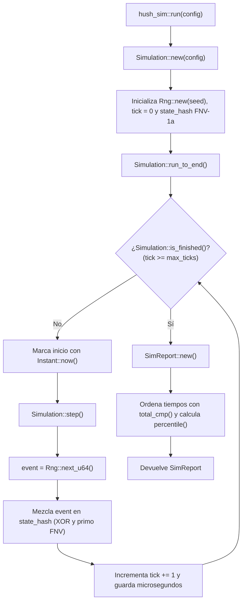

# Simulación determinista: `hush-sim`

El crate `hush-sim` (ubicado en `crates/hush-sim/`) es el corazón lógico de **HUSHMINE**. Aquí viven las reglas del juego, el reloj de la partida y la generación de números aleatorios, completamente aislados de la tarjeta gráfica, de la ventana y del sistema operativo.

Si revisas `crates/hush-sim/Cargo.toml`, verás que su única dependencia de producción es `serde` (para serializar datos) y que solo usa `serde_json` en las pruebas. No depende de `wgpu`, ni de `winit`, ni de ningún crate gráfico: **el mismo código exacto** se ejecuta en el servidor, en el cliente interactivo (`hush-client`) y en la herramienta de línea de comandos (`hush-cli`).

---

## Estructura de archivos hoy en `main`

En el estado actual del repositorio (Hito 0), `crates/hush-sim/` implementa el esqueleto de simulación determinista repartido en cuatro archivos:

| Archivo | Responsabilidad principal |
|---|---|
| `crates/hush-sim/src/lib.rs` | Punto de entrada del crate. Declara los módulos internos (`report`, `rng`, `sim`), reexporta los tipos públicos (`SimReport`, `Rng`, `MatchConfig`, `Simulation`, `TICK_RATE`) y ofrece la función `run()`. |
| `crates/hush-sim/src/rng.rs` | Define `Rng`, el generador pseudoaleatorio determinista basado en el algoritmo SplitMix64. |
| `crates/hush-sim/src/sim.rs` | Define la constante `TICK_RATE`, la configuración `MatchConfig` y la máquina de estados `Simulation`. |
| `crates/hush-sim/src/report.rs` | Define `SimReport`, el resumen estadístico y de verificación que se exporta a JSON al terminar una simulación. |

### 1. Punto de entrada (`crates/hush-sim/src/lib.rs`)

Es la fachada pública del crate. Expone una única función de alto nivel llamada `run()`:

```rust
pub fn run(config: MatchConfig) -> SimReport {
    Simulation::new(config).run_to_end()
}
```

Cualquier herramienta externa (como `hush-cli`) solo necesita construir un `MatchConfig` y pasarlo a `run()` para ejecutar una partida completa de principio a fin y recibir su `SimReport`.

### 2. Aleatoriedad controlada (`crates/hush-sim/src/rng.rs`)

Define la estructura `Rng`, que encapsula un único campo privado `state: u64` e implementa el algoritmo **SplitMix64**:

- **`Rng::new(seed: u64) -> Self`**: inicializa el generador con la semilla de la partida.
- **`Rng::next_u64(&mut self) -> u64`**: avanza `state` sumando la constante `0x9E37_79B9_7F4A_7C15` con aritmética modular (`wrapping_add()`) y mezcla los bits mediante desplazamientos y multiplicaciones envolventes (`wrapping_mul()`).
- **`Rng::below(&mut self, bound: u32) -> u32`**: obtiene un entero uniforme en el rango `0..bound` usando únicamente aritmética entera de 64 bits (`(((self.next_u64() >> 32) * u64::from(bound)) >> 32) as u32`), tras comprobar que `bound > 0`.

El archivo incluye tres pruebas automáticas en su módulo `tests`:
- `same_seed_same_sequence()`: comprueba que dos instancias de `Rng` con semilla `42` producen exactamente los mismos 1000 números consecutivos.
- `known_first_value_is_stable_across_platforms()`: verifica que con semilla `0` el primer valor de `next_u64()` es siempre `0xE220_A839_7B1D_CDAF`, garantizando compatibilidad entre arquitecturas.
- `below_stays_in_range()`: confirma en 10 000 tiradas que `below()` nunca devuelve un número fuera del límite pedido.

### 3. Reloj y bucle de partida (`crates/hush-sim/src/sim.rs`)

Aquí se modela el paso del tiempo discreto de la partida:

- **`TICK_RATE`**: constante fijada en `30` (30 ticks por segundo, la frecuencia del servidor autoritativo).
- **`MatchConfig`**: almacena `seed: u64` y `max_ticks: u32`. Su implementación de `Default` asigna `seed: 0` y `max_ticks: 16 * 60 * TICK_RATE` (es decir, `28_800` ticks, que equivalen a 16 minutos reales de partida).
- **`Simulation`**: contiene `config: MatchConfig`, el contador `tick: u32`, el generador `rng: Rng` y el acumulador `state_hash: u64`.
  - **`Simulation::new()`**: arranca en `tick: 0`, crea `Rng::new(config.seed)` e inicializa `state_hash` con el valor base del algoritmo FNV-1a de 64 bits (`0xCBF2_9CE4_8422_2325`).
  - **`Simulation::tick()`**: devuelve el número de tick actual.
  - **`Simulation::is_finished()`**: indica si `self.tick >= self.config.max_ticks`.
  - **`Simulation::step()`**: avanza la simulación exactamente un tick. Pide un número a `self.rng.next_u64()`, lo incorpora en `self.state_hash` y suma `1` a `self.tick`.
  - **`Simulation::run_to_end()`**: ejecuta un bucle `while !self.is_finished()`, cronometra en microsegundos cada llamada a `self.step()` usando `Instant::now()` y construye el `SimReport` final.

Sus pruebas unitarias (`same_seed_gives_same_final_state()` y `different_seeds_diverge()`) verifican que la misma semilla produce siempre el mismo `state_hash` y que semillas distintas divergen de inmediato.

### 4. Informe de simulación (`crates/hush-sim/src/report.rs`)

Define `SimReport`, que agrupa la huella final de la partida y las métricas de rendimiento de los ticks. Para calcular los percentiles de tiempo (`tick_p50_us` y `tick_p95_us`), ordena el vector `Vec<f64>` con `f64::total_cmp()` y consulta la función auxiliar `percentile()`. Además, incluye el módulo interno `hex_u64` con las funciones `serialize()` y `deserialize()` para que `state_hash` se escriba en JSON como una cadena hexadecimal de 16 dígitos fácil de leer y comparar. Sus pruebas son `report_round_trips_through_json()` y `percentile_of_sorted_values()`.

---

## Flujo de ejecución de `run()`

El siguiente diagrama muestra qué ocurre paso a paso cuando se invoca `hush_sim::run(config)`:



---

## Por qué la simulación tiene que ser determinista

Que `hush-sim` sea **determinista** significa que, si dos máquinas reciben la misma semilla (`seed`) y la misma secuencia de órdenes, ambas calcularán exactamente el mismo estado bit a bit en cada uno de los 28 800 ticks de la partida. Esto es imprescindible por cuatro motivos:

1. **Servidor autoritativo y predicción en cliente**: el servidor avanza a 30 Hz (`TICK_RATE`), pero el cliente necesita predecir el movimiento al instante para que los controles se sientan inmediatos. Si el cliente y el servidor calculan igual, la predicción coincide sin tirones.
2. **Repeticiones ligeras**: para guardar o reproducir una partida entera basta con almacenar la semilla inicial y las órdenes de los jugadores, sin grabar gigabytes de estado.
3. **Verificación automática por IA**: al ejecutar `hush-cli sim`, un agente puede comprobar si una optimización alteró el comportamiento del juego comparando un único valor (`state_hash`).
4. **Multiplataforma real**: una partida jugada entre un PC en Windows/Linux (x64 o ARM) y un navegador (WebAssembly) no puede desincronizarse.

### Las cuatro reglas de oro en `hush-sim`

- **Nada de `f32` ni `f64` en el estado del juego**: los números en coma flotante pueden redondear el último bit de forma distinta según el procesador o las optimizaciones del compilador. *Nota importante*: verás que `SimReport` sí contiene campos `f64` (`game_seconds`, `tick_p50_us`, `tick_p95_us`, `tick_max_us`), pero pertenecen exclusivamente al informe estadístico exterior generado tras medir con `Instant::now()`; nunca forman parte de `Simulation` ni influyen en `step()`.
- **Nada de aleatoriedad del sistema**: jamás se usa un generador del sistema operativo. Todo azar pasa por `Rng`.
- **Nada de iterar estructuras sin orden fijo**: las tablas hash estándar cambian el orden de sus elementos en cada ejecución. Cuando haya colecciones en el estado, se recorrerán siempre en un orden determinista (vectores indexados o árboles ordenados).
- **Nada de `panic!` ante entradas externas**: ni el servidor ni la simulación deben abortar si reciben datos corruptos o fuera de rango desde fuera; deben devolver un `Result` explicando el fallo.

---

## Qué es `state_hash` y qué mide `SimReport`

### El acumulador `state_hash` (FNV-1a)

En `Simulation`, el campo `state_hash: u64` funciona como un sello de integridad acumulado tick a tick mediante el algoritmo **FNV-1a de 64 bits**:

1. Al crear la partida en `Simulation::new()`, toma el valor base estándar `0xCBF2_9CE4_8422_2325`.
2. En cada `Simulation::step()`, combina el estado anterior con el nuevo evento usando la operación XOR (`^`) y multiplica de forma envolvente por el número primo FNV (`0x0000_0100_0000_01B3`):
   ```rust
   let event = self.rng.next_u64();
   self.state_hash = (self.state_hash ^ event).wrapping_mul(0x0000_0100_0000_01B3);
   ```

Gracias a este efecto avalancha, si dos ordenadores discrepan en un solo bit durante el tick 10 y la partida dura 28 800 ticks, el `state_hash` final será radicalmente distinto.

### Campos de `SimReport` en el informe JSON

| Campo | Tipo en Rust | Qué significa en el informe JSON |
|---|---|---|
| `seed` | `u64` | Semilla inicial con la que se configuró `MatchConfig`. |
| `ticks` | `u32` | Número total de ticks simulados (por ejemplo, `28800` para 16 minutos). |
| `game_seconds` | `f64` | Segundos de tiempo de juego simulados (`ticks / TICK_RATE`). |
| `state_hash` | `u64` | Huella final de 64 bits formateada como texto hexadecimal de 16 dígitos por `hex_u64`. |
| `tick_p50_us` | `f64` | Mediana (percentil 50) de lo que tardó `step()`, en microsegundos. |
| `tick_p95_us` | `f64` | Percentil 95 de duración de un tick en microsegundos (detecta picos frecuentes). |
| `tick_max_us` | `f64` | El tick más lento de toda la partida, en microsegundos. |
| `broken_invariants` | `Vec<String>` | Lista de reglas de integridad violadas durante la partida. **Siempre debe estar vacía (`[]`)**. |

---

## Evolución próxima del crate

En `main` tenemos el cimiento del Hito 0. En los siguientes pasos del plan ([PLAN_v4.md](../../PLAN_v4.md)), `crates/hush-sim/` crecerá con cuatro piezas clave sin romper ninguna de las garantías anteriores:

1. **Aritmética en punto fijo Q16.16**: un tipo numérico sobre `i32` (16 bits para la parte entera y 16 bits para la fracción) que permitirá calcular gravedad, velocidades y colisiones sin usar `f32`.
2. **Catálogo de los 18 tipos de bloque**: representados en memoria con un identificador compacto de un byte (`u8`) junto a su tabla de dureza, valor en mineral y comportamiento físico.
3. **El Sismógrafo**: un contador entero en milésimas de punto porcentual (`0..=100_000`) que avanza cada tick y se acelera con las explosiones, las líneas de cangilones en marcha, las descargas eléctricas y la lava que fluye hasta desencadenar el Despertar (*Wake*).
4. **Registro de eventos para la Crónica**: una bitácora determinista de los sucesos destacados de la partida (hallazgos, derrumbes, robos, extracciones) que alimentará el resumen narrativo al terminar.

---

## Cómo leer un error de Rust

El compilador de Rust es famoso por ser estricto, pero sus mensajes son en realidad un asistente que evita fallos difíciles de depurar en producción. Aquí tienes los tres errores más comunes explicados con código de `hush-sim`.

### 1. Préstamos y propiedad (borrow checker)

En Rust, puedes tener **muchos lectores simultáneos** (`&Simulation`) o **un único escritor exclusivo** (`&mut Simulation`), pero nunca dos referencias mutables activas a la vez sobre el mismo dato.

Imagina que intentamos guardar dos referencias mutables al generador `Rng` al mismo tiempo:

```rust
let mut rng = Rng::new(42);
let r1 = &mut rng;
let r2 = &mut rng; // <-- ERROR: segundo préstamo mutable mientras r1 sigue vivo
let a = r1.next_u64();
let b = r2.next_u64();
```

**Qué dice el compilador:**
```text
error[E0499]: cannot borrow `rng` as mutable more than once at a time
```

**Por qué ocurre y cómo se corrige:** Rust impide que dos variables (`r1` y `r2`) tengan permiso simultáneo para modificar `rng`, evitando que una pise el estado que la otra espera. La solución es hacer las llamadas de una en una directamente sobre el dueño:

```rust
let mut rng = Rng::new(42);
let a = rng.next_u64(); // Primer préstamo mutable: empieza y termina en esta línea
let b = rng.next_u64(); // Segundo préstamo mutable: totalmente válido
```

### 2. Tipos incompatibles (type mismatch)

En muchos lenguajes puedes sumar o asignar un entero de 32 bits (`u32`) a uno de 64 bits (`u64`) sin darte cuenta. En Rust no existen las conversiones numéricas silenciosas.

Supón que dentro de `Simulation::step()` intentamos mezclar directamente `self.tick` (que es `u32`) con `self.state_hash` (que es `u64`):

```rust
// self.state_hash es u64, pero self.tick es u32
self.state_hash = self.state_hash ^ self.tick;
```

**Qué dice el compilador:**
```text
error[E0308]: mismatched types
  --> crates/hush-sim/src/sim.rs:58:45
   |
58 |         self.state_hash = self.state_hash ^ self.tick;
   |                                             ^^^^^^^^^ expected `u64`, found `u32`
```

**Por qué ocurre y cómo se corrige:** en una simulación determinista, una conversión automática equivocada puede truncar bits o cambiar el signo sin avisar. Rust te pide que declares explícitamente la conversión sin pérdida usando `u64::from()`:

```rust
self.state_hash = self.state_hash ^ u64::from(self.tick);
```

### 3. Manejo de errores con `Result`

En `hush-sim` y en el resto del workspace está prohibido usar `panic!` cuando algo externo (un archivo JSON, un parámetro de red) puede fallar. Las funciones que pueden fallar devuelven un `Result<T, E>`, que tiene dos variantes: `Ok(valor)` si todo fue bien o `Err(error)` si hubo un problema.

Fíjate en cómo `hex_u64::deserialize()` en `crates/hush-sim/src/report.rs` lee el texto hexadecimal del JSON:

```rust
pub fn deserialize<'de, D: Deserializer<'de>>(d: D) -> Result<u64, D::Error> {
    let text = String::deserialize(d)?;
    u64::from_str_radix(&text, 16).map_err(D::Error::custom)
}
```

Si olvidaras el signo `?` al final de `String::deserialize(d)`, `text` no sería un `String`, sino un `Result<String, D::Error>`, y el compilador te avisaría de que no puedes pasar un `Result` a `from_str_radix()`.

**Cómo funciona el operador `?`:**
- Si `String::deserialize(d)` devuelve `Ok(cadena)`, el operador `?` extrae la `cadena` y la guarda en `text`.
- Si devuelve `Err(fallo)`, el operador `?` detiene la función inmediatamente y propaga ese `Err` hacia arriba, sin abortar el programa. Cuando necesitas decidir entre dos caminos en vez de propagar, usas `match` sobre `Ok` y `Err`.
