# Gráficos · 4. Shaders, luz y posproceso

Los shaders propios de Grisú: cómo se organizan, qué pases tiene un fotograma y qué aspecto da cada uno a la mina. Índice en [README.md](README.md).

---

## 1. Infraestructura

- **WGSL** en `crates/grisu-render/src/shaders/`, compilado por wgpu (naga). Ya se usa en `cube.wgsl`.
- **Preprocesador mínimo propio** (un archivo, sin dependencias): `#include "lighting.wgsl"` y variantes con `#ifdef` por preset y por plataforma (`PRESET_HIGH`, `WEBGL2`). Unas pocas decenas de variantes, no miles.
- **Todas las variantes se validan en las pruebas:** una prueba compila cada combinación con naga sin GPU. Un shader roto no llega nunca al juego.
- **Recarga en caliente** de WGSL en desarrollo (ya prevista en `PLAN_v4.md`).
- **WebGL2:** sin *compute shaders* ni almacenamiento en el *vertex shader*. Allí se usa la ruta clásica de vértices (ya prevista), partículas en CPU y un número fijo de luces dinámicas.

## 2. Un fotograma, pase a pase

```mermaid
flowchart LR
    A["Agrupar luces dinámicas"] --> B["Sombra de la lámpara (Alto)"]
    B --> C["Terreno opaco"]
    C --> D["Entidades y personajes"]
    D --> E["Cielo y horizonte"]
    E --> F["Agua, cristal y transparencias"]
    F --> G["Partículas"]
    G --> H["Haz de lámpara y polvo"]
    H --> I["Posproceso HDR"]
    I --> J["Vista de brazos"]
    J --> K["Escalado e interfaz"]
```

Se dibuja en **HDR** (`Rgba16Float`) hasta el mapeo de tonos. La vista de brazos va después del posproceso del mundo para no deformarse con los efectos de pantalla; recibe su propio mapeo de tonos.

## 3. Luz

### Luz de bloque en color
- Cada vóxel guarda **luz de bloque RGB (4 bits por canal) + luz de cielo (4 bits)**: 16 bits por bloque, solo en chunks cercanos y no uniformes.
- Se propaga con el BFS del hito 1, un canal por pasada. La lava da naranja, las balizas el color de su equipo, los cristales el suyo.
- **Luz suave:** se promedia en las esquinas de cada cara y se interpola, igual que la oclusión ambiental por vértice.
- Cambia `docs/mundo/01-escala-y-motor.md`, sección 5: de 4 + 4 bits a 12 + 4 bits por bloque.

### Luces dinámicas
- **Agrupadas por celdas de vista** (*clustered forward*): la pantalla se divide en celdas 3D y cada fragmento solo mira las luces de su celda. Hay un tope por preset (8–64).
- Son luces dinámicas: lámparas de casco, bengalas, explosiones, chispas, máquinas encendidas y criaturas que brillan.
- **La lámpara de casco** es un foco con cono, caída y un parpadeo suave si es de llama. En el preset Alto, **tu lámpara proyecta sombra** (un mapa de 512²). Las lámparas de los demás no proyectan sombra, salvo en Ultra.

### Luz de cielo
- En el modo Historia, el color y la fuerza del cielo dependen del **Párpado** (abierto, cerrándose, cerrado) y del bioma.
- En el modo Turno, todo es subterráneo: la luz de cielo no se usa.

## 4. Terreno

- **Vertex pulling** con caras de 8 bytes (ya en el plan), más el índice de variante, giro y máscara de texturas conectadas.
- Texturas de 32×32 con **muestreo nítido sin parpadeo** ([03-texturas-32.md](03-texturas-32.md), sección 8).
- **Luz de bloque en color + luz de cielo + luces dinámicas + oclusión ambiental.**
- **Brillo metálico:** menas y oro destellan cuando les da tu lámpara. En todos los presets.
- **Relieve** con el mapa de normales (Alto). Las caras de un vóxel están alineadas con los ejes, así que la base tangente sale gratis de la dirección de la cara.
- **Estratos** de color por altura y **humedad** (paredes oscuras y brillantes en las cuevas húmedas).
- **Niebla de mina:** por distancia y por altura, con el color del bioma o la dimensión. Bajo tierra es corta y espesa; sustituye al cielo.

## 5. Fluidos

| Fluido | Efectos |
|---|---|
| **Agua** | Transparencia ordenada por chunk, superficie que se mueve, color por profundidad. Medio: reflejo falso de las luces. Alto: refracción de la pantalla. Ultra: cáusticas en el fondo |
| **Lava** | Emisiva, con flujo animado en la dirección de la corriente, corteza que se agrieta y bloom. **Distorsión por calor** en la pantalla cerca de ella |
| **Grisú y aire malo** | Volumen apenas visible que solo se nota con la luz de la lámpara de seguridad, que cambia de color dentro |

## 6. Personajes y entidades

- Piezas instanciadas (ver [02-animacion.md](02-animacion.md)) con la misma luz que el terreno.
- **Tinte de equipo** por máscara en la textura: Copper y Cobalt sin duplicar texturas.
- **Tramado** al acercarse la cámara en tercera persona.
- **Destello de daño** (blanco, breve) y siluetas de muerte que se deshacen en polvo, sin sangre.
- **Distorsión de Ecos y Vigilias:** el modelo del minero con el vértice ondulado y transparencia por tramado.

## 7. Partículas

- **GPU** (*compute shader*) desde el preset Alto; **CPU** en Bajo y en WebGL2.
- Polvo al picar (con el color del bloque), chispas, escombros, gotas, ceniza, brasas, vapor, polillas de mica y motas de luz.
- **Polvo en suspensión:** motas que solo se ven dentro del cono de tu lámpara. Es la imagen de una mina.
- Las partículas que tocan la luz de bloque toman su color.

## 8. Superficie y cielo (modo Historia)

- **El Párpado:** una cúpula de piedra con la costura que se abre y deja pasar la luz. Su apertura es un parámetro animado del cielo.
- **Horizonte lejano:** los anillos de bajo detalle de `docs/mundo/01-escala-y-motor.md`, con **perspectiva aérea** (se desaturan y aclaran con la distancia).
- Sin sol ni estrellas: la luz sale de la costura. Es la única fuente grande de luz natural.

## 9. Posproceso

| Paso | Qué hace | Presets |
|---|---|---|
| **Adaptación a la oscuridad** | La exposición se ajusta despacio: al entrar en una galería oscura, los ojos tardan en acostumbrarse; al salir al Párpado abierto, deslumbra | Todos |
| **Bloom** | Brillo alrededor de lava, balizas, cristales y explosiones. Con submuestreo doble, barato | Ligero en Bajo |
| **Mapeo de tonos** | De HDR a pantalla con una curva fílmica suave que no quema los naranjas de la lava | Todos |
| **Gradación de color** | Una tabla LUT 3D por bioma y por dimensión, mezclada al cambiar de zona | Todos |
| **Viñeta y grano** | Leves; el grano evoca el fósforo y la película de la estética retro | Medio+ (se pueden quitar) |
| **Antialias** | FXAA opcional. Sin antialias temporal: emborrona el pixel art | Medio+ |
| **Escalado** | Render al 50–100 % y reescalado nítido con realce de bordes, escrito en WGSL | Bajo y Steam Deck |

## 10. Efectos propios de HUSHMINE

- **Haz volumétrico de la lámpara:** un trazado por pasos dentro del cono, con polvo. Medio en adelante.
- **Onda sísmica:** cuando sube el sismógrafo cae polvo del techo y una distorsión leve recorre la pantalla. Escala con el umbral y respeta «reducir movimiento».
- **Indicadores de ruido (accesibilidad):** anillos en el mundo y flechas en el borde de la pantalla que muestran **de dónde viene un ruido y lo fuerte que es**. Usan el mismo campo de sonido que la IA y el audio. Con el oído como mecánica central, esto no es opcional: va en todos los presets.
- **Pantallas de fósforo verde:** el sismógrafo del Vigía y las pantallas de la interfaz con líneas de barrido, persistencia y curvatura leve.
- **Lámpara de seguridad:** la llama cambia de color según el gas.
- **Visión de geófono:** al escuchar, el mundo se oscurece y aparecen ondas en las fuentes de sonido detectadas, en la dirección y la distancia que da la simulación.

## 11. Estilos por bioma y dimensión

| Zona | Aspecto |
|---|---|
| Mina del modo Turno | Sodio ámbar, polvo, sombras profundas. Es la referencia de la guía de arte |
| Cuevas de caliza y húmedas | Fríos, reflejos de agua, goteo con brillo |
| Manto y lava | Naranja y negro, distorsión por calor, brasas |
| Geodas | Luz refractada de colores, destellos |
| La Bóveda | Escala inmensa, niebla azul, polillas como estrellas |
| **El Sueño** | Colores lavados, aberración cromática leve, bordes que ondulan, transiciones suaves cuando cambia la época |
| **El Hervor** | Rojo constante, ceniza en el aire, calor en toda la pantalla |
| **El Eco** | Colores por frecuencia; los sonidos se ven como ondas y las plataformas de eco brillan al nacer y se apagan al morir |
| **El Revés** | Sobreexposición, blancos que ciegan, sombras como zonas seguras, paleta casi invertida |

## 12. Vistas de depuración

Cada una se activa en el juego y en `hush-cli shot --debug <vista>`:

`light` (luz de bloque en color), `sky`, `ao`, `normals`, `clusters` (luces por celda), `overdraw`, `chunks` (límites y estado), `noise` (campo de sonido), `lod` (horizonte) y `mips` (qué mip se usa).

La IA puede comprobar con una sola captura si la luz se propaga bien o si el horizonte encaja con los chunks.
