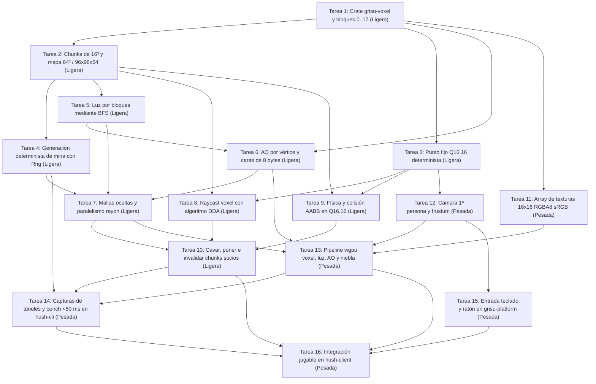

# Hito 1: Vóxel — Plan de implementación

Este documento desglosa en tareas atómicas y verificables el **Hito 1 («1. Vóxel»)** definido en `PLAN_v4.md`: representación del terreno en chunks de 16³, generación determinista de la mina de prueba, propagación de luz por bloques (BFS), oclusión ambiental por vértice (AO), extracción de mallas con caras empaquetadas en 8 bytes (*vertex pulling*), cámara en primera persona, física y colisión en punto fijo Q16.16, selección por raycast DDA y edición en vivo (cavar y poner bloques).

---

## 1. Resumen del objetivo y criterios de salida

Al cierre del Hito 0, el repositorio cuenta con la base de ventana (`crates/grisu-platform`), el contexto gráfico con `Gpu`, `OrbitCamera`, `DepthTarget`, `TextureData`, `CubeRenderer` y `render_to_image()` (`crates/grisu-render`), el bucle determinista con `Simulation`, `MatchConfig`, `Rng`, `SimReport` y `TICK_RATE` a 30 Hz (`crates/hush-sim`), el cliente (`crates/hush-client`) y la herramienta de línea de órdenes (`crates/hush-cli`).

El objetivo del Hito 1 es pasar del cubo aislado a una mina subterránea de vóxeles completamente recorrible, iluminada y editable tanto en ventana como en capturas sin ventana.

### Criterios de salida obligatorios

1. **Escenas de captura de túneles correctas:** `cargo run -p hush-cli -- shot` genera sin ventana imágenes PNG reproducibles de túneles subterráneos con estratos geológicos, vetas de mineral, bloques emisores (`lava`, `beacon`), iluminación por bloques (BFS), oclusión ambiental (AO) en las esquinas y niebla de distancia hacia `CLEAR_COLOR`.
2. **Presupuesto de regeneración (< 50 ms para 64³):** un mapa completo de 64×64×64 bloques (4×4×4 = 64 chunks de 16³, 256 KB de bloques) recalcula su iluminación y regenera todas sus mallas desde cero en **menos de 50 ms** en la máquina de referencia (ThinkPad T490s).
3. **Exploración y edición en primera persona:** `cargo run -p hush-client` permite caminar, saltar, subir escaleras, colisionar sin atravesar paredes en punto fijo Q16.16, apuntar mediante raycast DDA y cavar o colocar bloques actualizando en el mismo fotograma los chunks afectados y sus vecinos de borde.
4. **Verificación íntegra en verde:** `cargo fmt --all`, `cargo clippy --workspace --all-targets -- -D warnings`, `cargo nextest run --workspace`, `hush-cli shot`, `hush-cli sim` (con `broken_invariants` vacío) y `cargo deny check licenses bans sources` pasan sin errores.

### Regla de arquitectura y dependencias

- **Separación estricta entre motor y juego:** se introduce el crate del motor `grisu-voxel`. Cumpliendo la regla fundacional del repositorio, **ningún crate `grisu-*` depende de un crate `hush-*`**.
- El grafo de dependencias permitido es:
  - `grisu-voxel` → sin dependencias de `wgpu`, `winit` ni `hush-*`.
  - `crates/grisu-render` → depende de `grisu-voxel` para leer chunks y mallas empaquetadas.
  - `crates/hush-sim` → depende de `grisu-voxel` para compartir el terreno, el raycast DDA y la colisión en punto fijo Q16.16 entre cliente y servidor.
  - `crates/hush-client` y `crates/hush-cli` → unen `grisu-voxel`, `crates/grisu-render`, `crates/grisu-platform` y `crates/hush-sim`.

### Estrategia de trabajo en una máquina modesta (ThinkPad T490s · Intel UHD 620)

Compilar y enlazar `wgpu` y `winit` en cada cambio penaliza el ciclo de iteración en un portátil de 4 núcleos con gráficos integrados. Por ello el plan divide el hito en dos fases claras:

- **Tareas ligeras (Tareas 1 a 10 — solo CPU):** viven en `grisu-voxel` y `crates/hush-sim`, sin enlazar `wgpu` ni `winit`. Sus pruebas unitarias y de propiedades (`proptest`) compilan y se ejecutan con `cargo nextest run -p grisu-voxel -p hush-sim` en apenas 1–2 segundos.
- **Tareas pesadas (Tareas 11 a 16 — GPU y ventana):** tocan `crates/grisu-render`, `crates/grisu-platform`, `crates/hush-cli` y `crates/hush-client`. Se abordan cuando las estructuras de datos, mallas, luz y colisiones ya están probadas en CPU.

### Parámetros técnicos de referencia del Hito 1

| Parámetro | Valor canónico en el Hito 1 |
|---|---|
| Tamaño de chunk | 16×16×16 vóxeles (4 096 bytes de bloques + metadatos dispersos) |
| Mapa estándar (1c1 a 4c4) | 64×64×64 bloques (4×4×4 = 64 chunks, 256 KB en bloques) |
| Mapa grande (8c8) | 96×96×64 bloques (6×6×4 = 144 chunks, 576 KB en bloques) |
| Identificadores de bloque (`u8`) | `0 air`, `1 dirt`, `2 rock`, `3 hard_rock`, `4 ore`, `5 gold`, `6 diamond`, `7 lava`, `8 team_block`, `9 force_field`, `10 ladder`, `11 jump_pad`, `12 electric`, `13 rail`, `14 beacon`, `15 explosive`, `16 bucket_station`, `17 bucket_post` |
| Codificación de equipo | En los metadatos del bloque (*cobre* o *cobalto*), nunca duplicando el id |
| Formato de cara en malla | 8 bytes por cara visible (*vertex pulling*), más ruta clásica de vértices |
| Punto fijo de simulación | Q16.16 (`i32` con 16 bits fraccionarios) a 30 Hz (`TICK_RATE`) |
| Presupuesto de regeneración | Mapa de 64³ completo (luz BFS + mallas con `rayon`) en `< 50 ms` |

### Preparación para el mundo grande (W0, propuesta)

Ajustes baratos que dejan abierta la puerta a un mundo de 15 M × 15 M bloques (`docs/mundo/`, `docs/adr/0002-mundo-grande.md`). No cambian nada visible en el mapa de 64³:

- **Tarea 2:** el chunk se usa a través de `get`/`set`/`fill`, no como array público, y las coordenadas de chunk son `i32` con negativos (desplazamiento `>> 4` y máscara `& 15`).
- **Tarea 3:** además del Q16.16, se define la posición mundial de entidades en `i64` con 16 bits fraccionarios. Q16.16 solo alcanza ±32 767 bloques.
- **Tareas 8 y 9:** raycast DDA y colisión usan esa posición mundial. Sus pruebas incluyen coordenadas negativas y los extremos ±7 499 999. La gravedad entra como parámetro, no como constante, para las dimensiones del modo Historia.
- **Tarea 4:** el generador de la mina de prueba tiene forma de función pura por chunk: misma semilla y posición, mismo chunk.
- **Tareas 12 y 13:** el shader recibe el origen de cada chunk relativo a la cámara, nunca coordenadas absolutas en `f32`.

---

## 2. Desglose de tareas (16 tareas)

### Tarea 1: Creación del crate `grisu-voxel` y catálogo de bloques (`0` a `17`)

- **Objetivo:** Crear el nuevo crate `grisu-voxel` en el workspace y definir el catálogo canónico de 18 bloques (`u8` de `0` a `17`: `0 air`, `1 dirt`, `2 rock`, `3 hard_rock`, `4 ore`, `5 gold`, `6 diamond`, `7 lava`, `8 team_block`, `9 force_field`, `10 ladder`, `11 jump_pad`, `12 electric`, `13 rail`, `14 beacon`, `15 explosive`, `16 bucket_station`, `17 bucket_post`), junto con sus atributos estáticos (opacidad, solidez, dureza de excavación, nivel de emisión de luz) y el formato de metadatos por bloque donde se codifica el equipo (*cobre* o *cobalto*) sin duplicar identificadores.
- **Crate y archivos probables:** `Cargo.toml` de la raíz y nuevo crate `grisu-voxel` (`Cargo.toml`, `src/lib.rs`, `src/block.rs`).
- **Validación:** Pruebas unitarias en `grisu-voxel` que verifican las propiedades de los 18 identificadores (`0..=17`), la conversión segura desde `u8` devolviendo error ante valores `>= 18` (sin `panic!`), la emisión luminosa de `lava` y `beacon`, y la lectura/escritura del equipo en los metadatos.
- **Dependencias:** Ninguna.
- **Peso de compilación:** **Ligera** — compila únicamente `grisu-voxel` con tipos enteros puros en CPU, sin tocar `wgpu` ni `winit`.

### Tarea 2: Chunks de 16³ y cuadrícula del mapa (64³ y 96×96×64)

- **Objetivo:** Implementar la estructura de chunk de 16×16×16 vóxeles (4 096 bytes de bloques contiguos, tabla dispersa de metadatos y bandera de chunk sucio) y el contenedor del mapa completo capaz de alojar dimensiones de 64×64×64 (4×4×4 chunks, 256 KB) y 96×96×64 (6×6×4 chunks, 576 KB), con conversión entre coordenadas globales y coordenadas locales de chunk.
- **Crate y archivos probables:** Nuevo crate `grisu-voxel` (`src/chunk.rs`, `src/world.rs`, `src/lib.rs`).
- **Validación:** Pruebas unitarias y `proptest` en `grisu-voxel` que comprueban la biyección de índices `(x, y, z) <-> idx`, la lectura/escritura en los límites del mapa sin `panic!`, el almacenamiento disperso de metadatos y el tamaño exacto en memoria de los bloques (256 KB en 64³ y 576 KB en 96×96×64).
- **Dependencias:** Tarea 1.
- **Peso de compilación:** **Ligera** — estructuras en memoria dentro de `grisu-voxel`, sin dependencias gráficas.

### Tarea 3: Aritmética determinista en punto fijo Q16.16

- **Objetivo:** Implementar el escalar en punto fijo Q16.16 (`i32` con 16 bits enteros y 16 bits fraccionarios, resolución de 1/65 536 de bloque) y los vectores 3D/AABB asociados para representar posiciones, velocidades y cajas de colisión de forma idéntica en todas las arquitecturas sin usar `f32` ni `f64` en la simulación.
- **Crate y archivos probables:** Nuevo crate `grisu-voxel` (`src/fixed.rs`, `src/lib.rs`) y reexportación en `crates/hush-sim/src/lib.rs`.
- **Validación:** Pruebas unitarias y `proptest` sobre asociatividad de suma, multiplicación y división con acumulador intermedio `i64` sin desbordamiento silencioso, redondeo piso (`floor`) hacia coordenadas de bloque enteras y conversión unidireccional a `[f32; 3]` exclusivamente para la cámara.
- **Dependencias:** Tarea 1.
- **Peso de compilación:** **Ligera** — aritmética entera pura en `grisu-voxel` y `crates/hush-sim`.

### Tarea 4: Generación determinista de mina de prueba y escenas por semilla

- **Objetivo:** Crear un generador determinista basado en `Rng` (función `next_u64()` y `below()`) que construya un mapa de 64³ con techo y fondo de `hard_rock`, estratos de `dirt` y `rock`, vetas agrupadas de `ore`, `gold` y `diamond`, cámaras con `lava`, y una red de túneles excavados con bloques `beacon`, `ladder` y `team_block` lista para explorar y fotografiar.
- **Crate y archivos probables:** Nuevo crate `grisu-voxel` (`src/scene.rs`) y `crates/hush-sim/src/lib.rs`, `crates/hush-sim/src/rng.rs`, `crates/hush-sim/src/sim.rs`.
- **Validación:** Pruebas unitarias que generan dos mapas de 64³ con la misma semilla y comprueban igualdad byte a byte, presencia de aire transitable en el punto de aparición, proporción esperada de minerales y preservación del hash determinista en `Simulation`.
- **Dependencias:** Tarea 2.
- **Peso de compilación:** **Ligera** — generación en CPU sobre `grisu-voxel` y `crates/hush-sim`, sin inicializar la GPU.

### Tarea 5: Propagación de luz por bloques mediante BFS

- **Objetivo:** Implementar el cálculo de luz celular (`0..=15`, 4 bits por vóxel) mediante búsqueda en anchura (BFS) multi-origen desde todos los bloques emisores (`lava`, `beacon`) a través de bloques transparentes (`air`, `ladder`, `force_field`, `rail`), soportando propagación a través de las fronteras entre chunks vecinos y actualización local al excavar o colocar un bloque.
- **Crate y archivos probables:** Nuevo crate `grisu-voxel` (`src/light.rs`, `src/world.rs`).
- **Validación:** Pruebas unitarias que colocan un `beacon` en una galería cerrada y verifican la caída lineal del nivel de luz con la distancia Manhattan, el bloqueo total por paredes de `rock`, la continuidad del gradiente al cruzar el borde `x = 15 -> 16` entre dos chunks y la actualización tras abrir o tapar un tabique.
- **Dependencias:** Tarea 2.
- **Peso de compilación:** **Ligera** — algoritmo BFS en memoria dentro de `grisu-voxel`.

### Tarea 6: Oclusión ambiental (AO) por vértice y empaquetado de caras en 8 bytes

- **Objetivo:** Calcular para cada esquina de cara visible su nivel de oclusión ambiental (`0..=3`) muestreando los 3 vóxeles adyacentes del plano tangente, elegir la diagonal del cuadrilátero que evita bandas asimétricas, y empaquetar cada cara en exactamente 8 bytes (`u64` / `[u32; 2]`: coordenadas locales `x, y, z` en `0..16`, índice de normal `0..6`, capa de textura e información de equipo, luz de bloque y los 4 niveles de AO), ofreciendo además una función de expansión a vértices clásicos para compatibilidad.
- **Crate y archivos probables:** Nuevo crate `grisu-voxel` (`src/ao.rs`, `src/packed_face.rs`, `src/lib.rs`).
- **Validación:** Pruebas unitarias de ida y vuelta (*round-trip*) de los campos empaquetados en 8 bytes, comprobación de los 4 niveles de AO en esquinas cóncavas/planas y verificación del orden antihorario de los 2 triángulos con ambas diagonales.
- **Dependencias:** Tarea 1, Tarea 5.
- **Peso de compilación:** **Ligera** — manipulación de bits y tablas estáticas en `grisu-voxel`.

### Tarea 7: Extracción de mallas con eliminación de caras ocultas y paralelismo por chunks

- **Objetivo:** Implementar el extractor de mallas por chunk que emite únicamente las caras cuya celda vecina es no opaca (consultando las rebanadas limítrofes de los 6 chunks adyacentes) y paralelizar con `rayon` la reconstrucción de los chunks sucios, garantizando que el mallado más la iluminación de un mapa completo de 64³ tarde menos de 50 ms.
- **Crate y archivos probables:** Nuevo crate `grisu-voxel` (`Cargo.toml`, `src/mesh.rs`, `src/world.rs`).
- **Validación:** Pruebas unitarias del conteo exacto de caras (6 para un bloque aislado, 10 para dos bloques adyacentes, 0 caras interiores en un chunk macizo) y prueba de tiempo que reconstruye luz y mallas de los 64 chunks de una mina de 64³ por debajo del umbral de 50 ms.
- **Dependencias:** Tarea 4, Tarea 5, Tarea 6.
- **Peso de compilación:** **Ligera** — añade `rayon` a `grisu-voxel` pero se mantiene libre de `wgpu` y `winit`.

### Tarea 8: Raycast voxel (algoritmo DDA) para selección de bloque y cara

- **Objetivo:** Implementar el trazado de rayos sobre la cuadrícula mediante el algoritmo DDA (*Digital Differential Analyzer*) que avanza celda a celda desde el ojo del jugador a lo largo de la dirección de vista hasta alcanzar la distancia máxima de picado, devolviendo el bloque sólido impactado, la cara de entrada y la celda libre inmediatamente anterior.
- **Crate y archivos probables:** Nuevo crate `grisu-voxel` (`src/raycast.rs`, `src/lib.rs`).
- **Validación:** Pruebas unitarias y `proptest` con rayos paralelos a los ejes, rayos oblicuos, impactos en las 6 caras posibles de un bloque y rayos que terminan sin impacto al superar el alcance máximo.
- **Dependencias:** Tarea 2, Tarea 3.
- **Peso de compilación:** **Ligera** — cálculo geométrico puro en `grisu-voxel`.

### Tarea 9: Física y colisión AABB en punto fijo contra la cuadrícula

- **Objetivo:** Implementar la cinemática y resolución de colisiones del jugador con caja AABB en punto fijo Q16.16 a 30 Hz (`TICK_RATE`): integración de gravedad, salto desde el suelo, barrido y deslizamiento independiente por los ejes `y`, `x` y `z` contra bloques sólidos, trepado en `ladder`, impulso vertical en `jump_pad` y bloqueo o paso en `force_field` según coincida el equipo del jugador con el metadato del bloque.
- **Crate y archivos probables:** Nuevo crate `grisu-voxel` (`src/collision.rs`) e integración con `step()` en `crates/hush-sim/src/sim.rs` y `crates/hush-sim/src/lib.rs`.
- **Validación:** Pruebas unitarias y `proptest` de invariantes físicas: tras cualquier secuencia de entradas y velocidades, el AABB del jugador nunca solapa un vóxel sólido, aterriza de forma estable sobre el suelo, se desliza por pasillos en L, sube por `ladder` y respeta la pertenencia de equipo en `force_field`.
- **Dependencias:** Tarea 2, Tarea 3.
- **Peso de compilación:** **Ligera** — toda la física se valida en CPU dentro de `grisu-voxel` y `crates/hush-sim`.

### Tarea 10: Acciones de cavar y poner bloques con invalidación de chunks sucios

- **Objetivo:** Implementar las operaciones deterministas de **cavar** (reemplazar por `air` el bloque sólido seleccionado por raycast si no es `hard_rock` ni borde indestructible) y **poner** (colocar un bloque de construcción en la celda adyacente a la cara apuntada siempre que no intersecte el AABB del jugador), marcando como sucios el chunk editado y los chunks vecinos cuando la edición ocurre en las coordenadas locales `0` o `15`, y disparando la actualización de luz y malla para que quede lista en el mismo fotograma.
- **Crate y archivos probables:** Nuevo crate `grisu-voxel` (`src/edit.rs`, `src/world.rs`) y registro de acciones en `crates/hush-sim/src/sim.rs`.
- **Validación:** Pruebas unitarias que comprueban la prohibición de colocar un bloque sobre la cabeza o los pies del propio jugador, la inmunidad de `hard_rock`, el marcado de hasta 4 chunks sucios al editar una esquina `(0, 0, 0)` y la regeneración inmediata de la malla tras cavar.
- **Dependencias:** Tarea 7, Tarea 8, Tarea 9.
- **Peso de compilación:** **Ligera** — cierra la capa lógica de CPU en `grisu-voxel` y `crates/hush-sim` antes de pasar a `wgpu`.

### Tarea 11: Array de texturas procedurales 16×16 RGBA8 sRGB para los bloques

- **Objetivo:** Ampliar `TextureData` en `crates/grisu-render/src/texture.rs` para generar de forma determinista las capas de 16×16 píxeles RGBA8 sRGB de todos los bloques del Hito 1 (`dirt`, `rock`, `hard_rock`, `ore`, `gold`, `diamond`, `lava` con sus fotogramas, `ladder`, `jump_pad`, `electric`, `rail`, `explosive`, y los cinco bloques de equipo —`team_block`, `force_field`, `beacon`, `bucket_station` y `bucket_post`— en sus variantes cobre y cobalto) y subirlas a la GPU como *texture array* 2D por capas, conservando `test_ore()` para compatibilidad con `CubeRenderer`.
- **Crate y archivos probables:** `crates/grisu-render/src/texture.rs` y `crates/grisu-render/src/lib.rs`.
- **Validación:** Pruebas unitarias en `crates/grisu-render/src/texture.rs` que verifican que cada capa mide `16×16` (`1 024` bytes RGBA8), es determinista entre ejecuciones y presenta colores distinguibles por tipo de material y equipo.
- **Dependencias:** Tarea 1.
- **Peso de compilación:** **Pesada** — recompila `crates/grisu-render`, que depende de `wgpu`.

### Tarea 12: Cámara en primera persona y extracción de planos del frustum

- **Objetivo:** Añadir en `crates/grisu-render/src/camera.rs` (conviviendo con `OrbitCamera`) la cámara en primera persona definida por posición del ojo, ángulos `yaw` y `pitch` (acotado a `±89°`), cálculo de vectores de dirección horizontal para el movimiento, matriz `view_proj()` con perspectiva DirectX (profundidad en `0..1`) y extracción de los 6 planos del frustum para descartar los chunks cuya caja de 16³ cae fuera del cono de visión.
- **Crate y archivos probables:** `crates/grisu-render/src/camera.rs` y `crates/grisu-render/src/lib.rs`.
- **Validación:** Pruebas unitarias en `crates/grisu-render/src/camera.rs` que comprueban la saturación de `pitch`, la coherencia entre `eye()` y la dirección de vista, y el descarte por frustum de chunks situados detrás de la cámara.
- **Dependencias:** Tarea 3.
- **Peso de compilación:** **Pesada** — requiere compilar `crates/grisu-render`.

### Tarea 13: Pipeline wgpu de terreno voxel (*vertex pulling*, luz, AO y niebla de mina)

- **Objetivo:** Implementar en `crates/grisu-render` el renderizador de chunks que gestiona en la GPU los búferes de caras de 8 bytes por chunk (actualizando solo los chunks sucios), ejecuta el shader WGSL con *vertex pulling* (más ruta clásica de vértices cuando el adaptador no admita almacenamiento en el *vertex shader*), aplica el *texture array* 16×16 con muestreo *nearest*, combina sombreado direccional de las 6 caras, luz BFS y AO interpolado por vértice, funde con niebla de distancia hacia `CLEAR_COLOR` y dibuja el resalte del bloque seleccionado por raycast.
- **Crate y archivos probables:** `crates/grisu-render/Cargo.toml`, `crates/grisu-render/src/lib.rs` y nuevos módulos `src/voxel_renderer.rs` y `src/voxel.wgsl` en `crates/grisu-render`.
- **Validación:** Prueba de integración sobre `Gpu` con `headless()` y `DepthTarget` (obligatoria si `HUSH_REQUIRE_GPU=1`) que sube varios chunks iluminados, dibuja un fotograma y comprueba que no hay errores de validación de wgpu y que los píxeles cercanos y lejanos reflejan la luz del `beacon` y la atenuación de la niebla.
- **Dependencias:** Tarea 6, Tarea 7, Tarea 11, Tarea 12.
- **Peso de compilación:** **Pesada** — compila pipelines de `wgpu` y validación de shaders WGSL en `crates/grisu-render`.

### Tarea 14: Escenas de captura de túneles y banco de pruebas de 64³ en `hush-cli`

- **Objetivo:** Ampliar `crates/grisu-render/src/offscreen.rs` y el subcomando `shot` en `crates/hush-cli/src/main.rs` para renderizar sin ventana escenas de túneles de vóxeles (permitiendo elegir escena predefinida, semilla y pose de cámara sin romper la captura por defecto), e incorporar la verificación cronometrada de que la regeneración completa de un mapa de 64³ (luz BFS + mallas de los 64 chunks) tarda menos de 50 ms.
- **Crate y archivos probables:** `crates/grisu-render/src/offscreen.rs`, `crates/grisu-render/src/lib.rs`, `crates/hush-cli/Cargo.toml` y `crates/hush-cli/src/main.rs`.
- **Validación:** Ejecución de `cargo run -p hush-cli -- shot --out out/shot.png` revisando visualmente la captura PNG del túnel (texturas 16×16 nítidas, vetas de mineral, `lava`, `beacon`, sombras de AO en rincones y niebla al fondo) y comprobación automática del tiempo `< 50 ms` para 64³.
- **Dependencias:** Tarea 4, Tarea 10, Tarea 13.
- **Peso de compilación:** **Pesada** — enlaza `crates/grisu-render` y el binario `crates/hush-cli`.

### Tarea 15: Entrada de teclado y ratón en `grisu-platform` para primera persona

- **Objetivo:** Extender `crates/grisu-platform/src/lib.rs` y el trait `App` para recoger el estado de teclado (desplazamiento horizontal, salto, bajar en escalera, selección de bloque a colocar), el movimiento relativo del ratón para girar la cámara con captura del cursor dentro de la ventana y los botones izquierdo/derecho del ratón para cavar y poner bloques, manteniendo el cierre limpio con la tecla de escape.
- **Crate y archivos probables:** `crates/grisu-platform/src/lib.rs`.
- **Validación:** Pruebas unitarias de la estructura de estado de entrada (acumulación de deltas de ratón, puesta a cero al final del fotograma, pulsaciones simultáneas de teclas) y compilación sin avisos junto con `crates/hush-client`.
- **Dependencias:** Tarea 12.
- **Peso de compilación:** **Pesada** — recompila `crates/grisu-platform` (`winit` + `wgpu`).

### Tarea 16: Integración en `hush-client`: caminar, colisionar, cavar y poner bloques en la mina

- **Objetivo:** Actualizar `crates/hush-client/src/main.rs` para inicializar la mina de 64³ en `init()`, avanzar en `update()` un acumulador de tiempo fijo a 30 Hz (`TICK_RATE`) que ejecuta la colisión en punto fijo Q16.16, el raycast DDA y las órdenes de cavar (clic izquierdo) y poner (clic derecho) regenerando al instante los chunks sucios, y dibujar en `render()` los túneles iluminados y el contorno del bloque apuntado.
- **Crate y archivos probables:** `crates/hush-client/Cargo.toml` y `crates/hush-client/src/main.rs`.
- **Validación:** Batería completa de comandos de `AGENTS.md` (`cargo fmt --all`, `cargo clippy --workspace --all-targets -- -D warnings`, `cargo nextest run --workspace`, `hush-cli shot`, `hush-cli sim`, `hush-cli gpu`, `cargo deny check licenses bans sources`) y prueba en ventana con `cargo run -p hush-client`.
- **Dependencias:** Tarea 10, Tarea 13, Tarea 14, Tarea 15.
- **Peso de compilación:** **Pesada** — enlaza el binario final `hushmine` en `crates/hush-client` con toda la pila del motor y del juego.

---

## Grafo de dependencias

El siguiente diagrama muestra el orden de prelación entre las 16 tareas y destaca qué ramas pueden desarrollarse en paralelo (por ejemplo, la rama de iluminación y mallas en las tareas 5 a 7, la rama de física y raycast en las tareas 3, 8, 9 y 10, y la rama gráfica en las tareas 11, 12 y 15):

