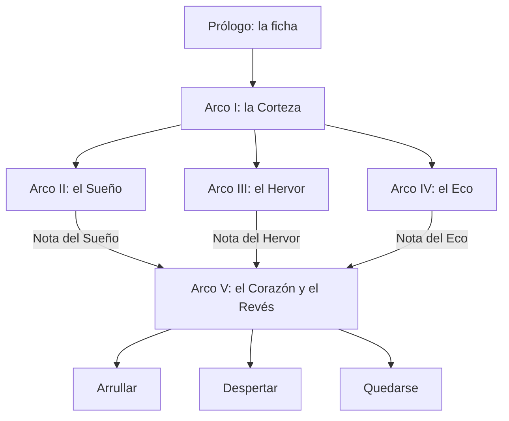

# Modo Historia · 2. La historia

El hilo principal del modo Historia: cómo empieza, cómo se ramifica, cómo termina y qué cambia de un mundo a otro. Índice en [README.md](README.md).

---

## 1. Estructura

- **Prólogo y arco I** son lineales: enseñan a sobrevivir, a construir y a callar.
- **Los arcos II, III y IV se juegan en cualquier orden.** Cada uno tiene lugar en una dimensión y termina con una **Nota**, una pieza de la Nana.
- **El arco V** necesita las tres Notas. Lleva al Corazón, al Revés y a uno de los tres finales.
- **Todo es opcional.** El mundo es abierto desde el primer minuto: la historia da motivos para bajar, pero no pone muros. En el modo **Libre** no hay hilo principal.
- **Después del final, el mundo sigue** con las consecuencias del final elegido.

## 2. Prólogo: la ficha

- Despiertas en el fondo de un pozo con una ficha. Tienes las manos y una lámpara que se apaga.
- Subes guiándote por un silbido (los Silbadores) y por la luz de una costura que se abre en el cielo: tu primer día.
- Llegas a un pueblo pequeño. **Siete**, la lampista, cuelga tu ficha en el tablero y te enseña la regla: *que no se oiga*.
- **Se aprende:** recolectar, fabricar las primeras herramientas, levantar un refugio antes de que se cierre el Párpado, encender luz y bajar a la primera cueva.
- **Termina** cuando tu ficha pasa una noche colgada en el tablero: ya eres vecino.

## 3. Arco I: la Corteza

- **Dónde:** de la superficie a −256, alrededor del macizo del Durmiente Mayor.
- **Qué pasa:** se reabren las **Minas de los Antiguos**, obras abandonadas por Llegados de quién sabe cuándo. Primer encuentro con **Tres Golpes** y los Quedos. Llega la **Consolidada** con su primer campamento y sus contratos. La Medidora regala tu primer sismógrafo.
- **Se aprende:** entibar, ventilar, tender raíles, leer el sismógrafo, ofrendar y comerciar.
- **Guardián:** **el Tapón**, un tapón de roca viva que sella el pozo maestro de la gran mina de los Antiguos.
- **Desbloquea:** las ramas **Oficio** y **Resonancia** básicas, y los planos de los tres pasos (el Lecho, la Boca de Horno y la Campana) para llegar a las dimensiones.
- **Revelación:** en el fondo del pozo sellado hay un tablero antiguo con fichas de números altísimos, como la tuya.

## 4. Arco II: el Sueño

- **Dónde:** el Sueño, al que se entra durmiendo en un Lecho.
- **Qué pasa:** el Sueño está hecho de recuerdos de los Llegados. Se encuentran **Soñados**: copias de personas que cuentan fragmentos de otros cielos. Se descubre que **las fichas guardan memoria** y que la tuya está vacía. Algo despierto se mueve por el Sueño: es la primera señal del Insomne.
- **Recuerdos jugables:** algunas fichas perdidas abren un **Recuerdo**, una noche en una mina de otra parte en la que la montaña despierta. Se juega con las reglas del modo Turno: sismógrafo, umbrales y 90 s de Despertar.
- **Guardián:** **la Pesadilla**, el Sueño reordenándose para echarte.
- **Recompensa:** la **Nota del Sueño** y la rama **Memoria**.

## 5. Arco III: el Hervor

- **Dónde:** el Hervor, bajo las raíces del mundo, al que se entra por una Boca de Horno.
- **Qué pasa:** se recorren las ruinas de los **Fundidores**, que forjaban con el calor de un Durmiente hasta que hicieron demasiado ruido y lo despertaron. Sus autómatas siguen trabajando. La Consolidada ha llegado antes: está construyendo **la Línea**, una cadena de cangilones colosal que baja hasta el Corazón del Durmiente Mayor.
- **Guardianes:** **la Caldera**, la gran caldera de los Fundidores, a punto de reventar; y **la Línea**, que hay que frenar.
- **Recompensa:** la **Nota del Hervor** y la rama **Presión**.
- **Revelación:** el plan del Apoderado. Quiere despertar al Durmiente Mayor para abrir su Corazón y, con él, el Párpado.

## 6. Arco IV: el Eco

- **Dónde:** el Eco, al que se entra tocando una Campana en silencio perfecto.
- **Qué pasa:** en el Eco el sonido es materia. Allí viven los Silbadores. Se descubre que sus silbidos son avisos y que los Quedos aprendieron de ellos a callar y a cantar nanas. **El Coro**, el gran conjunto de Silbadores, está desafinado por los Desvelos del Insomne.
- **Guardián:** **el Coro**. No se le vence: se le **afina**.
- **Recompensa:** la **Nota del Eco** y la rama **Resonancia** avanzada, con la receta de **la Nana**.

## 7. Arco V: el Corazón y el Revés

1. **El Despertar:** con la Línea o sin ella, la Consolidada provoca un **Despertar del Durmiente Mayor**. Es un evento de mundo con las reglas del modo Turno a gran escala: temblores en toda la región, lava, galerías que cambian de sitio y 90 s finales en el Corazón.
2. **La Nana:** con las tres Notas se construye la Nana junto al Corazón. Gana tiempo, pero no basta mientras el Insomne siga mirando.
3. **La Escala:** los Vigías guardan el plano de una torre para llegar al Párpado. Se construye (es una de las obras más grandes del juego) hasta la costura del cielo.
4. **El Revés:** al otro lado del Párpado está el **Insomne**. Es el jefe final.
5. **La decisión** llega después de vencerlo, junto a la costura abierta.

## 8. Los tres finales

| Final | Qué hace el jugador | Qué le pasa al mundo (que sigue jugable) |
|---|---|---|
| **Arrullar** (*Hush*) | Devuelve el Párpado a su ritmo y toca la Nana | Los Durmientes duermen hondo: menos temblores, menos oro soñado, noches largas y tranquilas. Las fichas perdidas empiezan a volver a los tableros. Es el final que pide el lema |
| **Despertar** (*Wake*) | Deja el Párpado abierto, como quería la Consolidada | **Se acaba la noche.** Los Durmientes despiertan poco a poco: el mundo cambia de reglas, con más oro, más peligro y galerías que se mueven solas. El Revés queda abierto para siempre |
| **Quedarse** (*Stay*) | Cuelga su ficha en el tablero del Revés y se queda | El personaje se convierte en el nuevo vigía del Párpado. Se sigue con un Llegado nuevo en el mismo mundo, que encontrará la ficha del anterior y oirá su voz por la radio |

Ningún final mata a un Durmiente: el Insomne es lo único que se combate.

## 9. Qué cambia en cada semilla

| Cambia | No cambia |
|---|---|
| Dónde está el Durmiente Mayor y cómo se llama su montaña | Los arcos, los guardianes y los finales |
| Pueblos, nombres de pueblos y de NPC (sus números) | Las ramas tecnológicas y las recetas |
| **Tu número de ficha** | Las reglas del ruido y del sismógrafo |
| La nota musical de cada Durmiente, que cambia los acertijos de resonancia | El reparto general de capas y dimensiones |
| Las arenas de los guardianes (estructuras generadas) | — |
| Qué recuerdos guardan las fichas perdidas y dónde están | — |
| Los encargos secundarios | — |

Todo sale de la semilla con la regla de `docs/mundo/`: el mundo es una función pura. Dos jugadores con la misma semilla viven la misma historia en el mismo mundo.

## 10. Historias menores

- **Fichas perdidas:** coleccionables por todo el mundo. Cada una guarda un fragmento de la memoria de un Llegado: un cielo con dos lunas, un mar de cobre, una canción. Son pistas que no encajan del todo.
- **Encargos de pueblo:** procedurales ([03-pueblos-y-comercio.md](03-pueblos-y-comercio.md)).
- **Rescates:** fichas que llevan días sin volver al tablero.
- **Los Antiguos:** una cadena de ruinas que cuenta, por fragmentos, quiénes cavaron antes.
- **El tablero de cuarenta y un ganchos:** está escondido en cada mundo y nadie lo explica ([01-lore.md](01-lore.md), sección 8).
